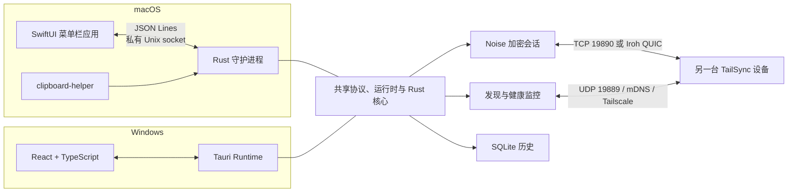

<div align="center">

[](README.md)
[](README.zh-CN.md)


# TailSync

### 让剪贴板跨设备自然流动

在 macOS 与 Windows 之间安全同步文本、图片和文件。

优先使用局域网，必要时通过 Tailscale 或 Iroh 连接，全程由设备身份和加密会话保护每一次传输。

[](#平台支持)
[](#平台支持)
[](#技术架构)
[](#安全模型)
[](https://github.com/monet4070/TailSync/tree/v2.3.1)
[](#许可证)

</div>

> [!NOTE]
> TailSync 2.3.1 目前处于积极开发阶段。macOS 与 Windows 客户端已经可以互相同步，并支持休眠/唤醒后自动恢复。tag 流水线默认生成免费的 Community Release：更新包仍有 TailSync 私钥签名、SHA-256 校验和降级保护，但 macOS 未公证、Windows 无商业代码签名；付费平台签名可在以后切换为 Trusted Release。本版本是一次以安全、稳定性与正确性为主的修复，不含新功能。首次公开发布前仍需完成真实设备验收。

## 为什么选择 TailSync

| | 能力 | 说明 |
|---|---|---|
| 📋 | 多类型剪贴板 | 双向同步文本、图片和文件，并保留本地历史记录 |
| ⚡ | 智能路由 | `auto` 模式优先选择可用的 LAN，必要时切换到 Iroh 或 Tailscale |
| 🔐 | 安全配对 | 六位验证码、双端确认、固定设备身份、Noise 加密连接和短时 Iroh 邀请链接 |
| 🩺 | 真实在线状态 | 单一后台任务主动探测，不再把残留的 mDNS 记录当成在线 |
| 🔋 | 唤醒恢复 | 睡眠唤醒后保留原始事件时间、取消过期连接并重置剪贴板监听 |
| 🔁 | 可靠传输 | 消息 ACK、自动重试、重放抑制、分块校验，以及双方应用重启后的续传 |
| 🗂️ | 智能历史 | 文本 / 图片 / 文件分类、日期筛选、搜索、收藏与恢复 |
| 👁️ | 富预览 | 在非模态预览窗口中查看任意历史条目：文本、代码高亮、Markdown、图片、PDF、DOCX、PPTX 与沙箱化 SVG |
| 🖥️ | 原生体验 | macOS 菜单栏 SwiftUI 应用，Windows 系统托盘 Tauri 应用 |

## 平台支持

| 平台 | 状态 | 客户端形态 |
|---|---|---|
| macOS | ✅ 可用 | SwiftUI 菜单栏应用 + Rust 守护进程 |
| Windows | ✅ 可用 | React / TypeScript / Tauri 桌面应用 |
| Android | 🧪 尚未支持 | 不属于当前跨平台兼容范围 |

macOS 使用原生 SwiftUI，Windows 使用 React/Tauri；两端共享 `shared/` 中的线协议、加密、历史存储和同步状态机，并通过跨平台漂移检查保持契约一致。

## 核心功能

- 文本、图片、文件双向同步
- 本地历史记录的搜索、收藏、恢复、受保护删除、数量限制，以及文本 / 图片 / 文件分类和日期筛选
- 独立的非模态历史预览窗口（`Space` 打开，`Space` 或 `Escape` 关闭）：文本搜索与字数/行数统计、保守检测的源码并显示行号、渲染后的 Markdown、图片（PNG / JPEG / GIF / WebP）、PDF、DOCX、PPTX 与沙箱化 SVG
- `auto`、`lan_only`、`iroh_only`、`tailscale_only` 四种连接策略
- UDP、mDNS / DNS-SD 与 Tailscale 候选发现
- LAN 与 Tailscale 独立健康检查及往返延迟显示
- `discovered`、`confirming`、`online`、`connected`、`offline` 状态模型
- Noise XX 握手、X25519 固定设备身份和 ChaCha20-Poly1305 加密
- 120 秒配对窗口、六位验证码、双向确认和失败锁闭
- 无自建服务器的 `tailsync://` Iroh 远程配对；链接一次性、120 秒后过期，仍需验证码与指纹确认
- 文本与图片事件的 ACK、重试、时间戳校验和消息 ID 去重
- 1 MiB 文件分块、BLAKE3 校验、偏移 ACK、发送端持久 journal，以及发送端或接收端重启后的续传
- 协商启用的文件滑窗：最多 4 个 1 MiB 分片在途并回读累计偏移 ACK；对旧对端回退为逐片确认
- 协商启用的 zlib 压缩图片分片（每片最多 512 KiB），限制解压大小、像素尺寸与顺序；压缩无收益时回退原始 RGBA
- Iroh QUIC 中继与打洞路径；测速复用应用常驻 Endpoint，报告重复的 `direct` / `relay` 路径类型与 RTT
- 睡眠 / 唤醒恢复：保留可靠事件时间、取消过期连接 worker 并重置剪贴板监听
- 守护进程健康检查纳入剪贴板监听存活状态，停止的监听不再被报告为健康
- 对 `clipboard-files/` 中受管文件的环路防护，避免已接收文件被回发给来源设备
- 文件名净化、单批次 1 GiB 接收上限和入站连接限制
- macOS 开机自启与 Windows 随系统启动，两端均提供系统级开关
- 中英文界面、本地化托盘菜单、浅色 / 深色 / 跟随系统外观、五个内置主题、通知、设备控制与路由选择
- 自定义主题（Theme V2）：导入包含 `theme.json` 清单和可选 `assets/` 的 `.tailsync-theme` 包，可与内置主题并列启用、更新或移除。主题选择是本地偏好，保存在 `themes-v2/local-settings.json`；缺失包回退到默认主题。详见 [`docs/THEMING.md`](docs/THEMING.md)。

## 技术架构



共享工作区按职责拆分为多个内聚 crate，而不是单一巨型核心：

- `shared/rust-core` —— 跨平台单一事实来源：数据加密密钥（DEK）、设置、持久设备身份、配对状态机、历史数据库、图片 / 文件生命周期、存储配额、文本 / 图片 / 大文件的可靠投递状态机，以及同步引擎。
- `shared/tailsync-protocol` —— 线协议类型、v5 帧头、编解码与契约测试。
- `shared/tailsync-runtime` —— 与传输无关的应用用例，例如历史分页、恢复载荷与历史变更。
- `shared/tailsync-history-classifier` —— 纯内容分类规则（文本、源码、命令、URL）。
- `shared/tailsync-themes` —— Theme V2 包格式、校验、解析、存储与读取策略。

平台相关的剪贴板访问、设备发现、连接池、Tauri / SwiftUI 桥接和系统托盘集成保留在应用 crate 内。两端都通过 `SyncPlatform` 适配器把平台能力接到共享同步引擎。`shared/` 下的 `platform-network-*.rs`、`platform-updates.rs`、`platform-clipboard-*.rs` 等文件是平台 Rust 模块的 canonical include 源，因此路由、网络与更新逻辑只维护一份。

## 快速开始

> 第一次使用 TailSync？[TailSync 实用指南](docs/USER_GUIDE.zh-CN.md)涵盖安装、配对、历史预览、文件批次、主题、存储管理与排障。该指南目前为简体中文。

1. 在 macOS 与 Windows 设备上分别启动 TailSync。
2. 在每台设备上打开连接界面，选择 `自动`、`仅局域网`、`仅 Iroh` 或 `仅 Tailscale`。Windows 上是**设置**中的一个分区；macOS 上是独立的**连接与设备**窗口，可从**设置**或应用菜单打开。
3. 在一台设备上选择**允许配对**，从另一台发起连接。确认两端显示相同的六位验证码和设备指纹。
4. 在两端确认后，复制文本、图片或文件即可自动同步。

> [!TIP]
> 局域网模式要求设备之间可直接路由。例如 `192.168.31.x/24` 与 `192.168.1.x/24` 默认属于不同子网，mDNS 通常也无法跨路由器。请配置网络间路由，或改用 Tailscale。

## 设备在线状态

TailSync 不会因为设备曾经被发现过就一直将其视为在线。单一后台健康监控任务每 5 秒探测一次：

| 状态 | 含义 |
|---|---|
| `discovered` | mDNS 或 Tailscale 提供了地址，但尚未收到有效响应 |
| `confirming` | 在线设备的首次健康检查失败；TailSync 等待下一轮再判定离线 |
| `online` | 近期收到 UDP 或 TCP 响应 |
| `connected` | 存在 Noise 认证连接，因此始终视为在线 |
| `offline` | 连续两轮检查失败且不存在已认证连接 |

正常情况下，断开连接的对端会在**约 8–12 秒内变为离线**。Tailscale 自身的 `Online` 状态仅表示设备已接入 tailnet；TailSync 仍会发送主动心跳以确认应用服务正在运行。

## 安全模型

- 每台设备都有持久化 X25519 身份密钥。
- 配对使用限时窗口、六位验证码和双端确认。
- 之后的连接执行 Noise XX 握手并校验已配对公钥。
- 认证失败时绝不降级到旧版明文协议。
- 相同主机名但公钥不同时拒绝配对，不再静默替换既有信任锚。
- 未认证的发现结果只作为本轮临时连接候选；只有通过固定公钥验证的握手之后才更新持久路由。
- 文本、图片和文件历史在静态时使用系统保护的数据密钥加密。
- 文件历史使用 1 MiB AES-256-GCM 分块容器；恢复操作只在受控的剪贴板目录中写入临时明文。
- 预览载荷上限 64 MiB，并在解密前后各校验一次；Markdown 经过净化，SVG 在禁用 JavaScript 的锁定离屏视图中渲染。

当前线协议为 v5。握手与配对帧仍保持在 v4，使已有对端无需先理解 v5 数据帧头即可完成协商：双方各自声明支持的最高 wire 版本与能力集，只有双方都声明 v5 时才使用 v5 数据帧。v5 新增文件滑窗（最多 4 个 1 MiB 分片在途并回读累计偏移 ACK）和 zlib 压缩图片分片；原子配对提交确认与原子文件批次继续有效。双方声明的版本不一致时会明确提示同时更新两端。已固定的设备身份在协议升级后仍然有效，无需仅因升级重新配对。当前产品版本为 2.3.1，数据库 schema 为 v11，这三个版本号彼此独立。

TailSync 会在首次启动时导入旧版 v1 历史数据库。迁移按内容哈希幂等；损坏条目写入诊断报告而不阻止启动。原始 `history.db` 与 `.fernet_key` 文件会保留，且不会被自动删除。

## 网络端口

| 端口 | 协议 | 用途 |
|---|---|---|
| `19889` | UDP | LAN / Tailscale 发现与健康心跳 |
| `19890` | TCP | 配对、认证与剪贴板数据传输 |
| macOS Application Support 下的 `tailsyncd.sock` | 仅本机 Unix socket | SwiftUI 外壳与 Rust 守护进程通信，带对端 PID 与能力令牌校验 |

局域网发现广播 mDNS 服务 `_tailsync._tcp.local.`。macOS 的本地 API 使用用户专属目录下的 Unix socket，不监听本地 TCP。Windows 本地 API 使用 `127.0.0.1:19889`，请勿通过端口转发暴露给其他设备。

## 从源码运行

### macOS

需要 Rust、Swift 5.9+ 和 Xcode Command Line Tools。

```bash
cd macos
xcode-select --install
./dev.sh
```

构建本地应用包：

```bash
./build-mac.sh
open TailSync.app
```

`build-mac.sh` 会构建 SwiftUI 外壳、Rust 守护进程和剪贴板助手。本地构建与 Community Release 默认使用 ad-hoc 签名；只有发布等级设为 `trusted` 且配置了 Apple 开发者凭据时才启用 Developer ID 签名与公证。

构建带 `Applications` 快捷方式、可直接附到 GitHub Release 的 DMG：

```bash
./build-dmg.sh
```

产物写入 `macos/release/`，并附带 SHA-256 校验和文件。生成带 updater 签名的 Community Release：

```bash
TAILSYNC_RELEASE=1 \
TAILSYNC_RELEASE_TIER=community \
TAURI_SIGNING_PRIVATE_KEY="..." \
./build-dmg.sh
```

Community Release 首次打开仍会触发 Gatekeeper 警告。将来具备付费签名账号后，可按[发布手册](docs/RELEASE.md)切换为 Trusted Release，无需更换 updater 密钥或线协议。

### Windows

需要 Node.js、Rust，以及安装了 **Desktop development with C++** 工作负载的 Visual Studio Build Tools。

```powershell
cd windows
npm ci
npm run tauri:dev
```

构建并冒烟测试 Windows 安装包：

```powershell
./scripts/package-windows.ps1
```

正式 tag 默认产出无 Authenticode 的 Community Release，但仍会生成并在发布时校验带签名的 updater ZIP。以后可用代码签名证书启用 Trusted Release。完整的密钥、证书与发布流程见[发布手册](docs/RELEASE.md)。

## 数据存储

macOS 默认数据目录为：

```text
~/Library/Application Support/com.tailsync.TailSync/
```

重要文件与目录：

| 路径 | 内容 |
|---|---|
| `history-v2.db` | 历史元数据、加密文本与内容引用；文本预览仅在读取时解密 |
| `file-history/` | 分块 AEAD 加密的文件历史容器 |
| `image-history/` | 加密的图片历史文件 |
| `incoming/` | 进行中接收的明文 `.part` 文件与跨重启状态，最多保留 24 小时 |
| `outgoing-transfers/` | 待发送文件批次与源路径的私有 journal，完成或过期后删除 |
| `clipboard-files/` | 恢复到系统剪贴板的临时明文文件，超过 10 分钟无引用后定期清理 |
| `themes-v2/` | 已安装的 Theme V2 包与本机主题选择 |
| `config-v2.json` | 设置、受信公钥与已知设备地址 |
| `identity-v1.bin` | 本设备的持久身份 |
| `iroh-identity-v1.bin` | 持久化的 Iroh Endpoint 身份 |

Windows 在系统应用数据目录中使用相同结构。重装或替换应用本身不会主动删除历史、身份或配对数据。

默认存储配额为 10 GiB，可在 1 GiB 到 16 TiB 之间调整。文本历史的 `description` 列只保存固定占位符；关键词搜索会先解密文本再匹配。删除历史时同时启用 SQLite `secure_delete` 并截断 WAL，使明文预览或已删除页不会残留在 sidecar 文件中。

## 开发与验证

文档分为当前规格与历史复核记录，索引见 [`docs/README.md`](docs/README.md)。实现变化时先更新当前规格；带日期的复核与交接文档作为历史证据保留，不要把它们过去的结论改写成当前状态。

```bash
cargo fmt --manifest-path shared/rust-core/Cargo.toml --all -- --check
cargo clippy --locked --manifest-path shared/rust-core/Cargo.toml --all-targets -- -D warnings
cargo test --locked --manifest-path shared/rust-core/Cargo.toml

cargo fmt --manifest-path shared/tailsync-runtime/Cargo.toml --all -- --check
cargo clippy --locked --manifest-path shared/tailsync-runtime/Cargo.toml --all-targets -- -D warnings
cargo test --locked --manifest-path shared/tailsync-runtime/Cargo.toml

cargo fmt --manifest-path macos/src-tauri/Cargo.toml --all -- --check
cargo test --locked --manifest-path macos/src-tauri/Cargo.toml --lib

swift test --package-path macos/swift-ui
```

修改共享源码时还应运行跨平台漂移检查：

```bash
node windows/scripts/check_cross_platform_sync.mjs \
  --win-root windows \
  --mac-root macos \
  --core-root shared/rust-core
```

打包 macOS 后，运行完整验证套件，覆盖前端、Rust、SwiftUI、Bonjour 声明、`19890` 监听、Unix socket API 与剪贴板助手：

```bash
bash macos/scripts/verify_macos_release.sh "$PWD/windows"
```

## 仓库结构

```text
TailSync/
├── macos/                 # macOS 客户端：SwiftUI 菜单栏应用、Rust 守护进程与打包脚本
│   ├── src-tauri/         #   Rust 守护进程与 macOS 平台适配器
│   ├── swift-ui/          #   SwiftUI 菜单栏外壳
│   ├── scripts/           #   漂移检查、迁移与发布验证
│   ├── build-mac.sh
│   └── build-dmg.sh
├── windows/               # Windows 客户端：React / Tauri 系统托盘应用
│   ├── src/
│   ├── src-tauri/
│   └── scripts/
├── shared/                # 跨平台共享工作区
│   ├── rust-core/         #   深度核心：加密、数据库、配对、设备、同步、Iroh
│   ├── tailsync-protocol/ #   线协议类型、v5 帧与契约测试
│   ├── tailsync-runtime/  #   与传输无关的应用用例
│   ├── tailsync-history-classifier/  # 内容分类规则
│   ├── tailsync-themes/   #   Theme V2 包格式与存储
│   ├── platform-*.rs      #   平台 Rust 模块的 canonical include 源
│   └── schema/            #   设置 schema 与生成的本地契约文件
├── docs/                  # 文档索引、用户指南、ADR、功能规格与发布 / 依赖手册
├── site/                  # 独立项目网站
├── tools/                 # updater 签名校验
├── .github/workflows/     # CI 检查
├── assets/                # 项目展示素材
├── README.md              # 默认英文说明
└── README.zh-CN.md        # 简体中文说明
```

macOS 与 Windows 的平台界面可以按各自系统体验独立演进；共享业务规则只在 `shared/` 各 crate 中修改。跨端合并前应通过生成契约检查、共享 core 测试、漂移检查和双向线协议测试。

## 当前限制

- 未完成的文件批次可在发送端或接收端退出、崩溃或重启后续传。发送端 journal 与接收端 `.part` 文件 / 清单最多保留 24 小时。续传从接收端最后校验通过的偏移开始，批次完成时再逐文件校验。详见[跨重启文件续传](docs/features/resumable-file-transfer.md)。
- v5 滑窗与压缩图片分片仅在双方都声明支持时启用；仅支持 v4 的对端会回退为逐片文件传输与原始 RGBA 图片。
- macOS 本地 JSON Lines API 使用用户专属目录下的 Unix socket，每个请求都要求对端 PID 校验和 256 位能力令牌。请求上限 1 MiB，读写超时各 5 秒。只有 Windows 本地 API 使用 `127.0.0.1:19889`，不应通过端口转发暴露。
- 历史正文与图片 / 文件载荷使用应用数据密钥加密；数据库中的类型、时间戳等元数据不加密，可借助全盘加密提供额外保护。
- 配对持久化仍存在 pending / active 一致性缺口（可能留下单边孤儿）；消除它需要设置结构升级与双端 UI 配合，安排在后续版本。
- tag 默认产出 Community Release：macOS 使用 ad-hoc 签名、未公证，Windows 无商业 Authenticode 签名，因此首次启动会触发 Gatekeeper 或 SmartScreen 警告。请勿通过关闭操作系统安全机制来绕过这些警告。
- updater 签名、稳定通道清单与降级保护均已实现，但使用本仓库凭据的首次在线更新与完整真机回归矩阵尚未完成。预发布 tag 不会进入稳定更新通道。
- Android 客户端尚未纳入当前实现与兼容性保证。

## 许可证

TailSync 核心代码以 [MIT 许可证](LICENSE)发布。

---

<div align="center">

如果 TailSync 对你有帮助，欢迎给项目点一个 ⭐

</div>
