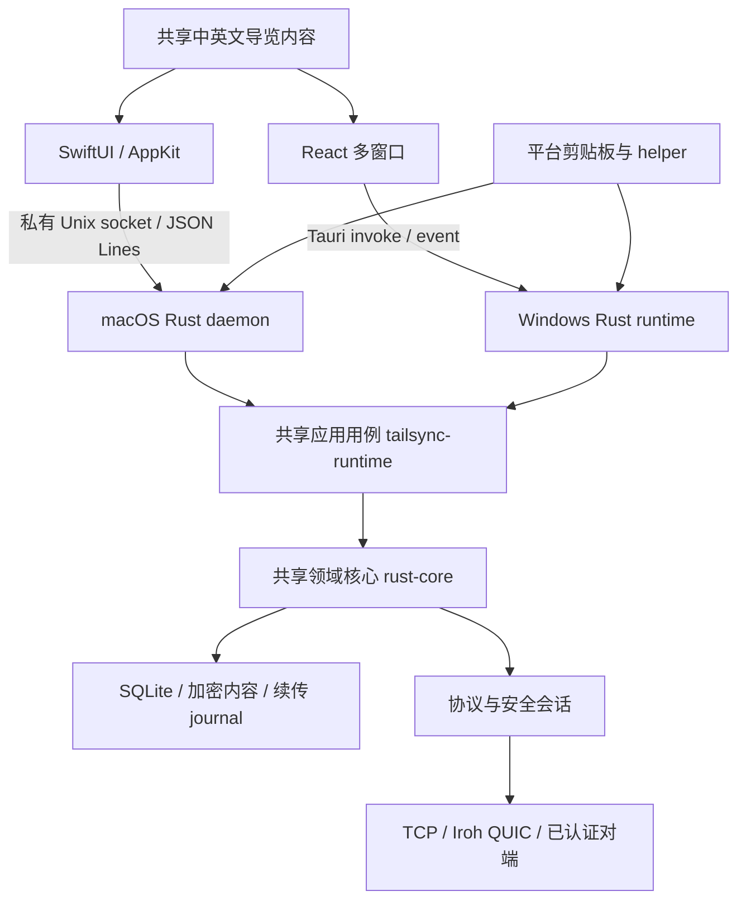

# TailSync 技术栈与架构审查 · 2026-10-22

本次按当前工作树审查模块、配置、入口、契约、测试和用户路径，并实现双端新手引导。仓库已有未提交的剪贴板/QQ 图片访问修改，予以保留。结论基于源码与下方实际执行的检查；不等同于全量安全审计、性能基准或双设备验收。

## 总体判断

当前技术方向适合 TailSync：平台原生交互各自实现，身份、配对、加密、存储、可靠投递等规则共用 Rust。无需为新手引导统一两端 UI 框架，也无需扩展线协议或数据迁移。主要复杂度来自跨平台边界、多个独立版本域、平台窗口/事件生命周期，以及实现与用户说明之间的漂移。

现有工程已具备深模块拆分、类型化本地契约、平台差异检查、功能开关、故障回归和发布分层。真正需要持续补强的是“用户走完整条路径”的证据：发现 → 配对 → 同步 → 历史/预览 → 休眠恢复 → 更新，不能以单模块通过替代真机闭环。

## 技术栈与职责

| 层 | 当前栈与入口 | 评价与约束 |
|---|---|---|
| macOS 外壳 | Swift Package / SwiftUI / AppKit，最低 macOS 13；`macos/swift-ui` | 菜单栏、全局快捷键、原生预览与权限交互自然；AppDelegate 仍承担大量窗口、服务及通知生命周期，继续按明确职责拆分 |
| Windows 外壳 | React 19、TypeScript 6、Vite 8、Tauri 2；多 HTML 入口 | 多窗口资源按入口拆分；窗口 label、capability、事件监听和命令注册必须一起维护 |
| 平台 Rust | `macos/src-tauri` 与 `windows/src-tauri` | 前者作为 daemon，后者持有 Tauri 运行时；系统 I/O 与共享用例隔离，不强求文件结构完全对称 |
| 应用用例 | `shared/tailsync-runtime` | 历史查询/恢复、预览、归档、来源信息和设备刷新；适合跨 transport 统一行为 |
| 领域核心 | `shared/rust-core`，Rust 1.91 / Tokio | 配对、设备健康、同步状态机、存储、更新验证；不应加入 UI 导览状态 |
| 协议与纯规则 | `tailsync-protocol`、`tailsync-history-classifier`、`tailsync-themes` | 编解码、分类、主题包校验分别测试，减少平台规则复制 |
| 网络 | UDP/mDNS/Tailscale 发现，TCP 19890，Iroh 1.1.0 QUIC | 路由发现、在线状态与认证会话分离合理；跨 NAT/中继与休眠行为需真实网络验证 |
| 安全与存储 | Noise XX / X25519 / ChaCha20-Poly1305；SQLite/rusqlite；历史负载加密与系统保护密钥 | 信任建立、内容落盘、文件恢复的边界清晰；数据库元数据及受控临时明文目录仍有独立生命周期 |
| 文档预览 | Windows 的 marked/highlight.js/DOMPurify/pdfjs/docx-preview；macOS 原生视图及受控 WebKit | SVG、HTML、外部资源是重点输入边界；现有沙箱、CSP、大小限制应继续以共享夹具校验 |
| 站点与工具 | 独立 React/Vite 站点、浏览器来源扩展、clipboard-helper、迁移/验收脚本 | 站点不是客户端引导宿主；helper 协议与应用协议必须单独管理 |
| 工程门禁 | Vitest、XCTest、Rust 测试/Clippy、生成契约与漂移检查、GitHub Actions | 覆盖面较广；测试工具链和真实桌面验收仍是关键依赖 |

版本来源：`windows/package.json`、`site/package.json`、各 crate Cargo.toml、`rust-toolchain.toml`、Swift Package.swift。这里列的是声明的技术栈，不将所有带范围版本的依赖表述为精确锁定版本。

## 运行链路与边界

- macOS 本地 IPC 为私有 Unix socket、对端 PID/能力令牌校验；Windows 使用进程内 Tauri 命令，不能把 UDP 发现端口误写为本地 UI API。
- `shared/platform-*.rs` 以 canonical include 维护共用编排。它减少漂移，但依赖目标 crate 的上下文，需同时检查两端以及默认/功能开启构建。
- 文本/图片是有界内存重试；文件是持久化 journal、已验证偏移与整批完成提交。产品说明必须区分这两种投递保证。
- 身份/基础兼容 v4、协商数据帧 v4/v5、条件历史 schema v11/v12/v13、本地契约、helper、指纹和 manifest 各自版本化，不能统称“协议版本”。
- 主题与引导属于本机 UI 偏好；不能通过同步核心把用户读到第几步当作跨设备业务状态。

## 发现与处理

| 优先级 | 发现与证据 | 本次处理 / 后续建议 |
|---|---|---|
| P1 | `windows/src-tauri/capabilities/default.json` 原本没有 `connections`，而连接页使用 `listen` 等 Tauri core API；页面生成不保证事件有权限 | 已加入连接窗口的现有基础 capability；仍需 Windows 原生事件链验收 |
| P1 | Windows `commands/remote_pairing.rs` 的邀请入口仍打开旧 settings 窗口，而邀请面板已迁至 Connections；首次启动导览还可能与邀请抢焦点 | 已改为连接窗口，并用待处理邀请状态与窗口状态抑制自动导览；仍需 Windows 冷启动/运行中链接验收 |
| P1 | `cargo check --all-targets` 在既有 `shared/platform-clipboard-capture-tests.rs` 失败：Windows test target 缺 `image`、`NativeArchive` 和 `read_archive` 适配 | 记录为当前工作树的既有测试阻断；生产库检查通过。应按平台条件隔离该 fixture，并补适配层实际能力，不能用放宽测试替代修复 |
| P1 | README/验收文档已明确 Windows 原生、真实双设备恢复、NAT/relay、更新发布链仍有开放验收项 | 不将“新增引导通过”提升为“产品可发布”；发布前补齐目标系统矩阵 |
| P2 | 首次启动仅驻留菜单栏/托盘，没有功能导览；复杂功能分散在窗口和操作菜单 | 已实现 15 步真实 UI 蒙版引导、窗口间定位、单次自动展示、永久关闭、演示历史与虚拟设备，以及错误重试 |
| P2 | 用户指南仍使用“设置 → 连接与设备”，开头写固定 schema v11；版本脚本也把这段旧文案当作固定模式 | 已修正实际入口与版本域；版本脚本只替换产品版本，避免发布时把协议说明改回旧值 |
| P2 | 两套 UI 内容容易分叉，现有 JSON/Swift 语言表各自维护 | 新导览采用共享 JSON + Swift 生成常量，并纳入现有 drift gate；不引入第三套翻译后端 |
| P2 | 本机默认 Apple 工具链受 Xcode 许可与 SDK/测试组件配置影响 | 使用 CLT + 已安装 26.5 SDK 验证生产 Swift 编译；完整 XCTest 运行结果见验证节。建议 CI 固定完整 Xcode 版本，避免依赖主机默认 SDK |
| P3 | `AppDelegate`、多窗口事件、多个 lockfile/平台 crate 及条件编译持续增加维护成本 | 后续按窗口管理、daemon 生命周期、系统通知等职责渐进拆分；维持独立 manifest 的发行边界和单一契约来源 |

## 新手体验的功能覆盖

| 步骤 | 实际高亮区域 | 覆盖能力 |
|---|---|---|
| 1–4 | 连接模式、配对按钮、设备列表、远程邀请面板 | 自动/LAN/Iroh/Tailscale、120 秒窗口、验证码与指纹、单设备开关、路由测速 |
| 5–10 | 历史列表、搜索与筛选、收藏星标 | 首次同步验证、文本/截图/文件、恢复、空格预览、长按收藏、条件富内容操作 |
| 11–15 | 常规、历史、存储、外观、更新设置 | 同步与快捷键、通知/开机启动、条数/配额/迁移、图片访问、主题包、语言、更新和排障 |

引导叠加在实际 UI 上，高亮区域保留交互；跨步骤自动滚动并打开相应真实窗口，配对弹窗优先展示。共享内容只描述用户操作，不复制业务状态机。条件能力用“条目提供时”限定。开发预览复用真实 React 页面并明确标注示例数据，不作为生产独立引导页。详见[规格](features/onboarding.md)。

## 验证记录

- Windows 前端：全量 **62 个测试文件 / 507 项测试通过**，其中 20 项覆盖蒙版引导、演示数据、永久关闭与重装后的缓存处理；生产构建保持原有五个窗口入口。
- Windows lint：退出成功，存在 React effect/dependency 警告；新增导览未引入 lint 错误。
- 生成命令注册、共享引导内容与跨平台契约：通过；版本与 CI scope 脚本 219 项通过（17 项跳过）。
- 一轮全量前端测试中，既有历史预览异步完成用例出现一次时序失败；该用例单独复测与最终全量 499 项复测均通过，未改动该用例。
- Swift 原生生产目标：使用 CLT + macOS 26.5 SDK 编译成功；引导 15 项与 AppBehavior 28 项 XCTest 通过，含真实收藏锚点、演示预览管线、实际连接控件渲染、重装重置与内置更新保留永久关闭状态。
- 安装生命周期收尾（2026-10-23）：Windows 原生标记的 3 项独立 Rust 回归测试通过，host `cargo check --locked --lib` 通过。macOS 已安装最新界面，daemon/helper 二进制逐字节保留；实测永久关闭后的设置入口消失、替换应用包重装后从第一步恢复、模拟配对后同步开关可操作，以及普通结束后从设置重开。未触发钥匙串授权。Windows NSIS 钩子与 WebView2 原生安装/更新流程仍需 Windows 验收，内置更新保留偏好目前由注入安装身份的回归测试验证。
- Windows Rust：macOS host 的 `cargo check --locked --lib` 通过；`--all-targets` 被上表既有剪贴板 fixture 阻断。host 编译不能验证 Windows 条件分支。
- 浏览器：在真实 React 页面组件上验证镂空点击、配对弹窗让位/恢复、搜索输入及窗口间步骤；检查连接 540×720、历史 400×600 等布局。预览 IPC 使用示例数据，不将网页预览当作原生命令端到端通过。
- 未执行生产配对、真实剪贴板双向发送、Windows 打包/运行、线上更新或发布。未改动用户现有配对和历史数据。

后续优先完成目标系统首启/跳过/重启、邀请启动优先级、窗口间操作及 VoiceOver/屏幕阅读器验收，再补齐既有跨平台测试阻断和发布矩阵。
