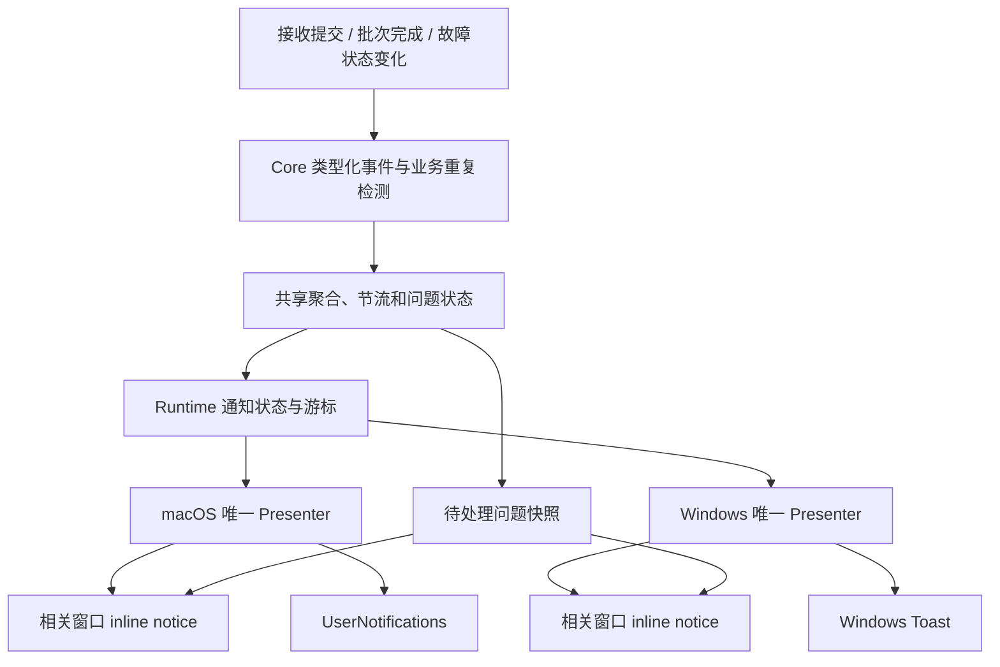

# TailSync 通知审查与改造方案

日期：2026-10-23。状态：**N1a 默认脱敏、本地化与 macOS 通知级别已完成源码实施及本地验证；其余仍为设计提案，双端原生行为尚未验收**。实施结果见[本轮修复记录](acceptance/notification-privacy-and-browser-image-2026-10-23.md)。

后续源码修复已将到达检测改为接收提交事件、按认证来源替换卡片，并统一 Windows 身份及原生投递。详细现状、全部路径和仍未验收的项目见[通知投递修复与路径](acceptance/notification-delivery-and-paths-2026-10-23.md)。本文的 F01/F03/F10 等表格保留原审查基线，不能据此推断这些问题仍存在于修复后的源码；完整 N2–N5 方案仍未全部实施。

本方案依据当前工作区源码、用户提出的七项要求以及 Apple / Microsoft 官方接口文档。Git HEAD 为 `620a963e683eb2bfffff5fb9cc7a00963b1fb6ff`，但审查对象是当前文件，不假定工作区与该提交完全一致。竞品行为不作为本方案的必要前提。

## 1. 目标与明确决策

用户应能知道哪台设备传来了什么类型的内容，连续同步不刷屏，通知不默认暴露正文，点击可以找到对应记录；重要错误经过节流后仍能在应用内找到。

采用以下决策：

1. 普通到达按稳定设备身份合并；文件按“设备 + 批次”合并；错误使用独立的问题标识。
2. 默认通知仅包含应用名、设备显示名、内容类型和数量。新增文本预览开关，默认关闭，包括升级用户。
3. 保留已有通知总开关及其当前值；本次不擅自把已开启的到达提醒改成默认静默。
4. 相关历史窗口在前台且可接收提示时，使用有界页内提示；否则由系统通知承接。仅窗口存在或可见不够。
5. 点击只导航、选中、滚动到条目或批次，不自动恢复剪贴板、不自动打开文件、不自动接受配对。
6. 共享层统一事件归一化、聚合、节流和错误状态；每个平台只有一个系统通知发射入口。
7. 通知去重、业务重复检测、通知中心替换和点击目标分别建模，不能用同一个 ID 同时承担四种职责。
8. 系统提醒开关、系统授权、页内错误状态分开处理。关闭横幅不会清除错误或把失败标成已处理。
9. 通知失败不能改变同步提交、文件回执和网络重试结果。系统 API 接受请求不等于用户已看见。
10. macOS 普通到达使用 `.passive`，需要处理的问题和待确认请求使用 `.active`。先利用系统通知级别降低打断，再根据体验证据决定是否加入复杂时间预算。

## 2. 当前代码事实与需要复现的风险

下表中的“确认”表示源码或官方文档已核实，不表示已在真实系统观察到横幅。

| 编号 | 判定 | 发现及影响 | 证据 |
|---|---|---|---|
| F01 | 确认 | macOS 从最新历史记录推断到达，用条目 ID 创建系统通知，正文可能使用 `description` | [TailSyncApp.swift](../macos/swift-ui/Sources/TailSync/TailSyncApp.swift)，`startNotificationPoller` |
| F02 | 确认 | Windows 后台任务也只取最新记录，跳过 `self` 和带 `batch_id` 的记录，但没有与 Swift 相同的空白来源过滤 | [Windows lib.rs](../windows/src-tauri/src/lib.rs)，`start_background_notifications` |
| F03 | 待复现的代码风险 | 远端记录与随后本机记录都在一次轮询前写入，读取最新一条可能越过远端记录；连续多条也没有明确的计数聚合语义 | F01、F02 的读取与游标推进顺序 |
| F04 | 确认 | macOS 文件成功的 headless `notify` 只记日志，实际到达反馈依赖历史轮询；Windows 文件完成由插件发出 | [macOS sync_adapter.rs](../macos/src-tauri/src/sync_adapter.rs)、[Windows sync_adapter.rs](../windows/src-tauri/src/sync_adapter.rs) |
| F05 | 确认 | 文本历史读取会解密并构造预览，随后可能送入系统通知。锁屏是否显示还取决于系统设置，不能断言所有机器都会直接展示 | [db/reads.rs](../shared/rust-core/src/db/reads.rs)、[db.rs](../shared/rust-core/src/db.rs)，`text_preview` |
| F06 | 确认 | macOS 已有同步警告及存储故障页内反馈，但并未统一覆盖所有 runtime error | [HistoryView.swift](../macos/swift-ui/Sources/TailSync/Views/HistoryView.swift)，`syncWarning`、`storageWarning` |
| F07 | 确认 | macOS 缓冲有溢出计数、最早 ID、服务实例；Windows 缺少这些元数据。两端进程生命周期不同，不能直接推定相同的重启故障概率 | [contracts.rs](../shared/tailsync-runtime/src/contracts.rs)、两端 `api.rs` |
| F08 | 确认 | Swift 当前没有通知 delegate，不能处理通知到条目的导航；系统通常会抑制应用前台展示，不能据此声称目前前台一定弹横幅 | [TailSyncApp.swift](../macos/swift-ui/Sources/TailSync/TailSyncApp.swift)、Apple 文档 A1/A2 |
| F09 | 确认 | 替换已送达的同 identifier 通知会再次提醒。替换通知中心条目不能代替节流 | Apple 文档 A1 |
| F10 | 确认 | Windows 后台 Toast 从 `app.config().identifier` 读取身份；当前配置为 `com.tailsync.desktop`。Cargo bundle metadata 的另一 identifier 是一致性问题，不代表该路径的取值未知 | [lib.rs](../windows/src-tauri/src/lib.rs)、[tauri.conf.json](../windows/src-tauri/tauri.conf.json)、[Cargo.toml](../windows/src-tauri/Cargo.toml) |
| F11 | 确认 / 待原生验证 | Windows 平台有 Tag、Group、SuppressPopup 能力；当前包装库是否完整暴露、安装与便携注册及冷启动激活能否正常工作需做适配验证 | Microsoft 文档 W1–W4 |
| F12 | 确认 | 多条系统通知路径和页内路径使用硬编码英文或原始错误字符串；原始错误可能包含路径等非公开信息 | 两端 `sync_adapter.rs`、`clipboard.rs`、`lib.rs` |

已有可复用基础：`retry_state` 的发送重试节流、`sync_warning` 的显式确认、Windows `useHistoryNotice` 的 TTL / 可见预算、Swift 的 cursor/gap 测试、两端历史窗口选中状态。后续在这些边界上改造，避免重复实现。

## 3. 用户可见行为

| 事件 | 后台时 | 相关窗口正在前台时 | 点击目标 |
|---|---|---|---|
| 本机复制或来源无法确认为远端 | 不产生到达通知 | 正常历史更新 | 无 |
| 远端文本、图片、图文到达 | 按设备聚合，显示类型、设备及数量 | 有界 inline notice，历史正常更新 | 最新一条对应记录 |
| 文件批次处理中 | 现有进度展示，不逐文件发到达通知 | 现有进度条 | 无新增系统通知 |
| 文件批次完整提交 | 一批一条，使用完整批次总数 | 一条批次完成提示 | 展开并定位该批次 |
| 已保存但未能完整写入剪贴板 | 使用准确的警告，不宣称“可直接粘贴” | 警告提示和处理入口 | 已保存条目 + 问题详情 |
| 同一错误重复发生 | 首次提醒，后续计数和节流 | 有界提示，问题列表保留 | 对应问题/连接/存储设置 |
| 存储不可用 | 状态首次进入失败时提醒 | 常驻状态说明 + 问题入口 | 存储设置 |
| 存储恢复 | 清除活动故障；前台显示一次恢复提示，后台默认不再弹成功横幅 | 同左 | 无需新增系统通知 |
| 配对请求 | 独立可操作提醒，受请求有效期约束 | 配对界面内处理 | 现有确认界面 |

配对提醒只导航至现有确认流程，保留身份校验和双方确认。首版不在系统通知按钮中直接批准配对。

## 4. 身份设计：四类键各司其职

| 标识 | 用途 | 示例 / 规则 |
|---|---|---|
| `origin_key` | 合并同一业务事实从多个回调重复上报的情况 | 接收操作 ID + 阶段；设备 ID + batch ID + complete；错误操作 ID + code |
| `(service_instance, notification.id)` | 检测 IPC 重放和同一投递的重试 | 服务实例为随机字符串；ID 为实例内单调序号 |
| `replacement_key` | 决定通知中心中哪张卡片被替换 | `arrival:<peer-id>`、`files:<peer-id>:<batch-id>`、`issue:<issue-id>` |
| `action_token` | 查找点击后应定位的目标 | 仅本机有效的随机 token，关联条目/批次/问题 |

`origin_key` 必须在生产者边界保留。若两个调用方分别创建两个新通知 ID，消费者仅凭 `(service_instance, id)` 无法判断它们来自同一次失败。

普通到达的替换键不含 entry ID。entry ID 属于点击目标，放在本机 token 关联的记录中。macOS 的 `userInfo`、Windows 的 activation arguments 仅携带受限动作及 token。这样既能按设备替换，又能点击定位。

设备身份取已认证会话提供的稳定 ID，不取 hostname、IP 或展示名。文件接收已经有 `FileReceiveCommit.source_device_id`；其他接收路径应沿用认证上下文。设备改名不改变分组，两台同名设备不会合并。缺少可靠设备身份时不把多台设备合到一个“unknown”组。

Windows Tag / Group 使用符合 SDK 长度约束的映射，保存完整 key 与映射关系并检测碰撞；不能直接把任意长度的设备名拼入 Tag。

## 5. 共享事件、策略与投递边界



### 5.1 模块职责

- `shared/rust-core/src/notifications/`（拟新增）：类型化业务事件、稳定语义键、纯聚合/节流/问题状态机。时钟由调用者注入，单元测试不 sleep。Core 不依赖 Tauri、AppKit 或 WinRT。
- `shared/tailsync-runtime/src/notifications.rs`（拟新增）：拥有一个通知服务实例，接收事件、驱动定时器、组装快照、保存问题元数据和点击目标，提供确认与查询应用用例。
- 平台接线：向共享层提供提交结果、认证设备身份、设置和真实窗口状态；禁止在 `sync_adapter`、`clipboard`、存储监控中直接发系统通知。
- macOS `NotificationPresenter.swift`（拟新增）：唯一系统发射点、权限和 delegate、主线程导航、与历史窗口的页内交接。
- Windows `notifications.rs`（拟新增）：常驻 Rust Presenter；独立于历史 WebView 是否打开。React 只负责页内渲染和渲染确认。

不把整个通知服务塞进 Swift 历史轮询，也不让 Windows 各窗口各自消费后发系统通知。每端只注册一个系统 Presenter；历史/收藏等窗口可以读取同一问题状态。

### 5.2 事件产生位置

| 事件 | 唯一生产边界 | 禁止的替代判定 |
|---|---|---|
| `clipboard_received` | 远端接收结果完成结算，记录已保存并有准确的应用结果 | `history_version` 改变或“最新一条不是 self” |
| `file_batch_received` | 完整批次历史及接收回执提交成功，拿到稳定批次引用 | 每个文件落盘、chunk 完成、进度达到 100% |
| `receive_degraded` | 已保存但发布为 partial/unknown 等需要处理的类型化结果 | 一律当成功，或从英文错误字符串猜状态 |
| `issue_raised/updated/resolved` | 操作结算或状态转移的责任方 | 同时由 helper、调用方、UI 各发一次 |
| `pairing_requested` | 已有配对请求对象进入待确认状态 | 仅检测到设备或收到未知链接 |

同一接收操作若降级，则形成一条警告结果，不再同时产生普通成功横幅。网络重试、重复回执和重新读取历史不产生新的“收到”事实。

用户随后本机复制导致远端发布被 `superseded`，通常属于正常竞争结果：可以表示“已收到/已保存”，不得声称已写入剪贴板，也不默认升级成待处理错误。实际内容丢失或无法保存才进入相应问题类别。

现有文件适配方法的返回值不能完整表达条目目标、是否本次新提交及发布结果，实施时应增加类型化提交结果或由共享接收用例接收这些结果。通知不能阻塞网络 ACK；后提交通知失败不重新执行剪贴板发布，也不撤销数据库提交。

普通到达事件首版采用提交后的尽力投递。提交成功到事件入队之间若进程崩溃，允许少一条成功提醒，数据仍在历史中；不为成功横幅另建事务 outbox。重要失败通过问题状态和已有持久业务状态恢复。

### 5.3 拟定 IPC 形状

以下为设计契约，最终以 Rust 定义及生成器产物为准，不直接手改生成文件。

```text
RuntimeNotificationV2 {
  id: DecimalString,
  kind: NotificationKind,
  level: info | warning | error,
  occurred_at_ms: SafeInteger,
  replacement_key: String,
  source_peer_id?: String,
  source_display_name?: String,
  content_kind?: text | image | composite | file | mixed,
  count: SafeInteger,
  batch_id?: String,
  issue_id?: String,
  message_code: NotificationMessageCode,
  action_token?: String,
  expires_at_ms?: SafeInteger
}

NotificationStateV2 {
  protocol_version: 2,
  service_instance: String,
  earliest_available_id: DecimalString,
  high_watermark_id: DecimalString,
  dropped_total: DecimalString,
  events: [RuntimeNotificationV2],
  issues_revision: DecimalString,
  active_issues: [NotificationIssue]
}
```

两端 runtime snapshot 增加同一种可选 `notification_state`，通过 capabilities 的 `notification_protocol_version` 声明支持。Windows Rust Presenter 从同一服务订阅，不依赖 WebView 轮询。

新契约的实例与 64 位计数采用字符串，避免把 macOS 当前纳秒级 `u64 service_instance` 原样交给 JavaScript `number` 丢失精度。旧字段在兼容期保留其既有类型，不悄悄改变旧解码器。

`message_code` 由类型化事件选择；参数只允许设备名、类型、数量等已定义字段，不允许任意 `message` 或参数 map 混入原始错误。新增事件类型必须同时补双端文案和未知类型的安全降级行为。

### 5.4 快照与确认

1. `events`、最早 ID、高水位和 dropped 计数在同一一致性边界获取。
2. Presenter 先判定实例变化与 gap，再处理当前窗口内可用事件；高水位不代表全部已渲染。
3. 事件只有在“系统 API 接受 / 页内确认渲染 / 策略明确抑制或过期”后才能标记 handled。失败不得无条件推进处理游标。
4. 页内槽位拒绝、窗口隐藏或 WebView 未挂载不等于已展示。有限重试后重新检查前台状态；需要处理的错误始终留在问题快照。
5. OS API 失败以相同事件身份做有界重试；失败信息进入诊断或页内状态，不递归产生另一个系统错误通知。
6. 服务实例变化时重置流游标、重新对齐问题状态；不能盲目重放旧历史。单独 UI 重连使用其已处理游标和仍有效的待投递记录。
7. 初次启动用原子快照建立基线，并优先在启动同步工作前注册消费者。macOS UI/daemon 启动期间保留新鲜事件；不补弹上次运行的普通到达。
8. gap 提示归入页内诊断，每实例合并一次，不因事件风暴再制造 gap 横幅风暴。

读取位置与展示结果分开记录：允许有界的 pending 集合保存已读取但未处理的事件；已处理水位只越过连续完成的区间。单条 OS 失败达到重试上限后进入明确的失败终态，不能无限阻塞后面的错误事件。活动问题快照的可见性不依赖该瞬时事件是否仍在日志中。

只保证单一发射入口与可控重放，不承诺跨进程崩溃的系统通知 exactly-once。进程可能在系统接受后、记录结果前崩溃；稳定替换键和持久问题元数据降低重复影响，但无法证明用户只看见一次。

## 6. 合并、节流与时间参数

本节为后续可选优化，**不是 N1a 独立交付的前置门槛**。先验证脱敏、`.passive` 与前台展示，再判断哪些聚合参数仍有必要。按设备替换、批次去重和错误不被覆盖仍是独立的正确性目标。以下常量仅在决定实施相应预算后，用模拟时钟及真实体验验证，不全部暴露为设置项。

| 项目 | 建议值 | 语义 |
|---|---|---|
| 剪贴板突发聚合 | 安静窗口 800 ms，最长等待 2 s | 窗口内累计条目数，保存最新目标；持续输入也有明确发射上限 |
| 同设备普通到达冷却 | 15 s | 冷却内更新待发摘要，期满最多发一条；重复内容不延长已展示 inline 的 TTL |
| 普通到达全局预算 | 30 s 内最多 3 次系统提醒 | 多设备轮流发送也不会无限打断；超额进入待发聚合 |
| 普通到达待发有效期 | 60 s | 过期只保留历史，避免解锁或恢复后补弹一串旧提醒 |
| 文件完成 | 完整批次一次；受普通到达全局预算约束 | 超额合并/延后，最多保留 5 min 的待发摘要 |
| 同一问题重提醒 | 首次一次；仍未解决时最短 5 min | 可操作性或严重程度升级允许新一轮提醒，仍受错误预算约束 |
| 错误全局预算 | 30 s 内最多 3 次 | 超额合并成“有多项问题需要处理”摘要，在下一个可用名额发送；摘要也占预算 |
| 瞬时投递日志 | 256 项 | 仅用于短暂断连重放，容量不是可靠性保证 |
| 活动问题 | 最多 128 个聚合问题槽位 + 独立溢出摘要 | 与普通到达分开，不被到达事件挤掉 |

调度时刻取安静窗口、最长等待和预算可用时刻的组合；预算门控优先于 2 秒体验目标。正常低频到达不额外等待 15 秒，冷却从上一条被选择展示的到达起算。系统明确失败的请求不算成功展示，但重试也必须有总次数上限。

上述 15 秒冷却和全局预算限制系统横幅；页内反馈沿用有界 notice 的时间规则。Core 使用平台提供的 `PresentationContext` 运行统一的渠道选择函数，预留展示名额，Presenter 返回提交结果后确认或释放预留。原生适配层只在实际展示前复查状态变化并请求重新决策，不另写一份业务节流规则。

同设备在 0–700 ms 连续收到 10 条文本：在最后一条后 800 ms 输出一条“来自 MacBook 的 10 条内容”，点击定位本次摘要的最新条目。一个包含 10 个文件的批次：只在完整提交后输出“已收到 MacBook 的 10 个文件”。这些数量来自提交事件，不从最后一条历史推测。

同设备跨越多个时间窗口持续发送，可能按预算出现多次横幅，但通知中心始终只有该设备的一张普通到达卡片。不同文件批次保留各自目标；错误卡片使用独立命名空间。

冷却期间不反复调用 macOS `add` 去“静默刷新”，因为同 ID 的已送达通知仍会再次提醒。等待下一次允许的发射时，再同时更新可见摘要和点击目标。Windows 可以在原生能力确认后优化静默更新，但首版采用两端一致的节流语义。

## 7. 隐私、设置和本地化

### 7.1 设置项与迁移

| 字段 | 默认 / 升级行为 | UI 文案 |
|---|---|---|
| `notifications_enabled` | 保留已有值；新用户沿用当前默认 true | 系统通知 |
| `notification_arrivals_enabled`（新增） | 默认 true；受总开关约束 | 内容到达提醒 |
| `notification_preview_enabled`（新增） | 默认 false，缺字段也为 false | 显示文本预览 |

总开关开、到达提醒关即可得到“只提醒问题及待处理请求”的模式，不再额外引入一个与两个布尔值冲突的模式字段。总开关关则所有系统通知关闭，包括配对提示；已有配对界面和页内错误继续工作。

预览开关说明：“开启后，文本内容可能显示在锁屏和通知中心。”首版仅支持纯文本预览，最多 100 个 Unicode 字符；图片、图文和文件继续使用类型/数量，不包含缩略图、文件名、路径、URL 标题或富文本。

不尝试用正则保证“密码/验证码能被识别并剔除”。安全默认值是完全不发送正文。预览关闭时，通知链路不应为了构造 body 调用完整历史解密读取；若开启，则在最终展示前按目标读取最小预览，失败回退类型文案。

预览不进入持久通知元数据、点击参数或通知日志。设置关闭后，取消尚未发出的预览，并移除本应用已送达的到达通知；应用只能尽力撤回系统记录，无法撤回已经被用户或系统看到的内容。

设置读取先完成，再消费第一批待展示事件；读取失败采用预览关闭的默认值。发送时再次检查最新设置，避免异步预览读取期间用户关闭开关仍发出正文。

### 7.2 系统授权状态

应用开关表达用户偏好；另显示系统状态：“已允许 / 系统已关闭 / 尚未授权 / 暂不可用”。不因为系统拒绝就改写用户偏好。

macOS 在启动、应用重新激活和进入设置时读取通知授权状态。显式开启且尚未决定时请求授权；已拒绝时提供系统设置入口。Windows 以当前使用的 API 和注册状态判断能力，不能把“请求提交成功”当作权限已允许。

拒绝系统通知时页内问题仍可见。Focus / 勿扰由系统裁决，不通过声音、置顶窗口或 time-sensitive 级别绕过。首版保持无提示音。

macOS 到达提醒的底层级别明确为 `.passive`，其官方语义是不亮屏、不播放声音；错误与需要处理的请求为 `.active`，仍服从系统设置。实际横幅、通知中心保留和前台行为分别验收，不用“只改一行”代替原生观察。Windows 不借用 macOS 的结论。

### 7.3 文案单一来源

新增 `shared/notifications/messages.json`（拟定），维护有限的中英文消息代码及参数定义，并生成 Swift、TypeScript 和 Rust 可用资源。Windows 后台 Rust 在 WebView 关闭时也必须能生成当前语言文案，因此不能只新增 React 翻译 key。

| 消息代码 | 简体中文示例 | 英文示例 |
|---|---|---|
| `arrival.text` | 来自 MacBook 的文本 | Text from MacBook |
| `arrival.image` | 来自 MacBook 的图片 | Image from MacBook |
| `arrival.composite` | 来自 MacBook 的图文内容 | Rich content from MacBook |
| `arrival.summary` | 来自 MacBook 的 10 条内容 | 10 items from MacBook |
| `arrival.files.one` | 已收到 MacBook 的 1 个文件 | Received 1 file from MacBook |
| `arrival.files.other` | 已收到 MacBook 的 10 个文件 | Received 10 files from MacBook |
| `issue.storage_unavailable` | 存储暂不可用，文件传输已暂停 | Storage is unavailable. File transfer is paused. |
| `issue.received_not_applied` | 内容已保存，但未能更新剪贴板 | Content was saved, but the clipboard could not be updated. |
| `action.target_unavailable` | 该记录已删除或不可用 | This item was deleted or is unavailable. |

“重试中”“已停止”“已恢复”按实际状态选择文案，不能把永久失败写成正在重试。未知消息代码使用本地化的通用类型文案，不显示 key 或原始错误。设备名去除控制字符、限制长度，并按平台格式转义；取当前本机保存的显示名。

## 8. 前台抑制与页内展示交接

“前台”定义为：相关窗口可见、未最小化、拥有焦点，并且其提示宿主已挂载。Windows 需要本地窗口焦点/最小化状态和 WebView 可见性；macOS 使用应用激活状态与实际窗口状态。仅打开设置页或某个无关窗口，不吞掉历史到达事件。

Presenter 选择 `system / inline / suppressed / deferred` 中一个结果，记录可观测原因。页内提示和系统横幅不是两个独立订阅者各自决定；同一投递只选择一个瞬时提醒通道。

Windows 复用 `useHistoryNotice`，保留同 key 不续命、8 秒可见预算和 1.5 秒冷却。Swift 新增等价的有界提示状态，按同一份策略用例校验。两端都为错误保留处理入口，不把错误永久挂在短暂提示槽里。

inline 提交后再确认 displayed；受冷却拒绝时仍待处理。准备展示过程中窗口失焦，重新判定是否转系统通知；已经确认页内展示的事件不再补弹横幅。需要利用 delivery token 和 pending/in-flight/handled 状态防止竞态双发。

macOS delegate 的 `willPresent` 是最后一道检查：相关窗口此时可处理则返回空集合，并进行幂等的 inline 交接；否则按策略允许 banner/list。不能无条件返回空集合，否则用户在设置窗口中也可能收不到重要提醒。delegate 回调必须及时完成，不等待网络或历史查询。

系统仍可能因 Focus、授权或平台行为隐藏已接受的请求；不据此推定用户看见，也不立即在其他通道制造补弹。

## 9. 点击定位：热启动和冷启动都要定义

### 9.1 统一导航用例

新增应用用例 `resolve_notification_action(token)`，返回受限目标：历史条目、历史批次、问题详情或既有配对请求。token 是导航索引，不是授权凭据；它不能指定任意文件路径、外部 URL 或命令。

本机保存目标引用、有效期、数据集代际及可校验的历史身份。切换存储目录或重新创建数据集时使旧引用失效；无需为通知修改设备间 wire 协议。对旧格式条目使用已有类型、时间和内容身份等字段复核，不能仅凭可能复用的 row ID 打开另一条记录。

普通到达 token 建议有效 1 小时，文件完成 24 小时；问题 token 随问题生命周期保留，已失效配对请求不再可操作。注册表有总容量和过期清理，淘汰后点击安全降级到相关窗口及“记录不可用”提示。token 映射不保存正文、文件名或原始错误。

需要冷启动定位的 token 必须先可靠保存，再向 OS 提交通知。保存失败时仅提供“打开历史/问题列表”的通用导航，不宣称能够定位某一条。数据集代际是拟新增的本机元数据，必须接入新建库、换库和恢复入口；普通应用重启不轮换。

点击处理顺序：

1. 校验动作版本与 token，验证目标仍存在且身份匹配。
2. 打开已有历史窗口或创建窗口，等待宿主就绪。
3. 保存用户原查询，临时切换到能展示目标的查询上下文，并提供返回原查询入口。
4. 通过共享 `locate_history_target` 用例获取目标所在页/批次，不只在当前页查找。
5. 等待该查询的结果提交，再展开批次、设置键盘焦点、滚动到目标并短暂高亮。
6. 只有导航成功，才确认该点击及清理相应到达通知。点击前后发生删除则显示不可用提示，不误选下一条。

`locate_history_target` 必须复用历史排序和文件批次分页规则，返回查询版本或可校验定位结果。分页期间新增记录导致偏移变化时重查一次，再做安全降级；不能靠循环拉取所有历史。已有 `focusedId` / `focusedEntryId` 可复用，恢复成功动画状态不可用作导航选中态。

对于被后续到达替换的卡片，token 必须与当前可见摘要一起更新；错误卡片不得覆盖同设备到达卡片，也不得被其覆盖。

导航完成后的清理还需比对卡片的投递修订号：若期间同一设备已有更新的通知替换了旧卡片，处理旧点击不能顺手删除新卡片。用户查看历史也仅清理已实际覆盖到的到达记录，不能清除未解决错误。

### 9.2 平台激活

- macOS：启动早期设置并强引用 `UNUserNotificationCenterDelegate`；`didReceive` 保存待导航请求，在 daemon 与窗口准备后消费。普通点击不需要 Category；只有增加自定义按钮时才注册 Category。
- Windows：运行中使用 Toast 激活回调；关闭状态需要应用身份与可重新启动的激活注册，仅 `on_activated` 闭包不够。优先验证现有 deep-link/单实例入口承接 `tailsync://notification/<token>` 的能力，与配对 URL 路由严格分开。
- Windows 安装版必须验证开始菜单身份、注册、进程未运行时的启动、单实例转发和历史页挂载后的定位。
- 便携版单列能力：运行中点击必须工作；冷启动需要有效注册及稳定可执行路径。若便携模式缺少该条件，明确显示能力限制，不能声称与安装版完全一致，也不静默写系统注册来伪装支持。
- 冷启动期间先保存 pending action，再等待就绪；不能只 `emit` 一次给尚未创建的 WebView。多次点击保留最新导航意图，以 request ID 防止旧请求覆盖新选择。

## 10. 错误的保留、确认与恢复

错误分成“瞬时提醒”和“问题状态”。瞬时提醒受预算限制，问题状态独立保存，普通到达不能占用或清空它。

`NotificationIssue` 包含稳定 `issue_id`、类型化 code、设备/子系统范围、首次/最近发生时间、次数、状态、修订号、处理目标和最近已确认修订。相同问题更新次数与目标，不新建无穷卡片；不同错误类别或批次使用明确的归并规则。

生命周期：

```text
发生 -> active/unseen -> active/seen -> resolved
                    \-> 用户关闭瞬时提示（问题仍 active）
resolved 后再次发生 -> 新的一次故障周期，可重新提醒
```

“已显示”“用户已查看”“问题已解决”是三个不同事实。关闭通知不解决故障；错误恢复由业务状态触发，不能靠 TTL 把活动故障消掉。已有存储故障常驻说明继续反映实际状态。

历史页增加紧凑的“待处理问题 N”入口与问题列表；短暂 inline 消失后仍能找到原因和导航动作。列表按严重程度、发生时间排序；不新建覆盖操作区的固定浮层。

重要问题元数据写入本机私有通知状态文件，采用现有私有文件与原子替换能力，避免依赖正在故障的历史存储。只持久化有限枚举、内部引用、计数和时间，不保存剪贴板内容或异常字符串。写入失败保留内存状态，并通过应用内状态显示“问题记录暂无法保存”，不递归弹系统通知。

重启后先从存储健康、发送任务等权威业务状态对账，再展示持久问题；不能仅凭旧文件把已恢复的故障重新弹一遍。已解决/已查看的非活动记录建议保留 7 天；活动问题不按年龄自动消失。达到 128 个槽位时按相同类别/设备汇总，超出部分进入独立溢出问题并保留数量和诊断入口；不承诺无限保留每次独立错误的明细。

`retry_state` 继续控制发送重试与该重试产生的提醒资格。共享通知层再施加最终频率预算，不修改网络退避时间。存储监控继续按状态转移上报，5 秒轮询不等于每 5 秒新增问题。

`sync_warning` 分批迁移为类型化事件。兼容期间由单一桥接器按“旧 warning 服务实例 + warning ID”去重；旧 UI 与新 Presenter 互斥消费，确认发生在新页内提示可见或问题记录可靠接管之后。不得两个消费者各弹一次，也不得入队失败就 ack 旧警告。

## 11. 平台接入及旧路径退出

| 当前位置 | 目标改动 |
|---|---|
| macOS `TailSyncApp.startNotificationPoller` | 移除“取最新历史推断到达”；交给唯一 Presenter 消费共享通知状态；启动基线与取消逻辑保留 |
| macOS `sync_adapter.notify` / clipboard 错误 | 上报类型化结果；取消到达/错误的系统通知直调和仅日志成功旁路 |
| macOS `HistoryView` | 接入 inline delivery、问题状态和 pending navigation；保留现有存储说明及恢复操作语义 |
| Windows `start_background_notifications` | 由共享通知订阅替代历史推断任务，不保留第二条成功到达源 |
| Windows `sync_adapter` / `clipboard` / 存储监控 | 全部通过共享上报接口；移除 `.notification().builder().show()` 的对应直调 |
| Windows `History.tsx` | 渲染已路由的 inline 事件和问题状态，确认可见提交，处理 pending navigation |
| 两端 `api.rs` | 共用通知缓冲实现与快照契约，禁止各自再维护独立策略 |
| 设置中的测试通知及其他手工提示 | 测试通知也经 Presenter；不占用真实到达/错误替换键，不写历史 |

Windows 优先基于已有固定版本 `windows = 0.62.2` 实现小范围原生通知适配，补所需 features；先验证 Tag/Group/activation/history removal。若现有包装库足以完整支持则复用，若不足则替换该边界。禁止把包装库缺少方法解释成 Windows 平台不支持。

Toast 身份统一以实际 Tauri 配置和安装注册为依据；修正不一致的 bundle metadata 前检查其是否仍参与打包。开发构建、安装版、便携版分别验收，不承诺移动 exe 会自动修复注册。

## 12. 契约迁移与回退

1. 为通知能力单独增加版本字段，沿用现有 local contract 扩展方式；不顺手修改网络、数据库、helper 或内容 identity 版本。
2. `Settings`、`SettingsPatch`、字段白名单、默认值、校验、Swift 模型与编辑协调器都要同步扩展；TypeScript 设置类型由 Rust schema 生成。
3. 使用 `generate-local-contracts.mjs` 更新 Swift/TS/JSON 契约、解码器和正反例；64 位值与未知事件必须有跨语言用例。
4. 新旧输出通过每端唯一的运行模式切换；可以旁路计算新策略做诊断，但只能一套向系统发射。不得开启“双发对比”。
5. 首先发布或实现旧路径的正文脱敏与文案修复，使回退目标也不默认泄露正文。
6. 切换到新 Presenter 时撤销旧的 `tailsync-<entry>` 与 runtime 通知，再启用新命名空间。Windows 无法可靠枚举来源时按已验证的应用身份处理，不清除其他应用通知。
7. 新 UI 遇到旧 daemon 时采用明确兼容降级：普通到达只发脱敏类型摘要，未知错误采用通用本地化提示；无法保证时停止该系统提醒并在应用内提示升级。不得直接显示旧 raw message 作为兜底。
8. 回退到已做脱敏的旧发射路径，保留问题元数据和用户设置；不重放迁移前普通到达。无关功能不得受通知迁移开关影响。

macOS 外壳与 daemon 必须作为配套版本更新并校验包内组合。未做脱敏的旧 UI 仍可能从普通历史接口读取正文，因此“新 daemon + 任意旧 UI”不属于隐私保证的兼容组合；包验收必须排除该混装情况，不能仅靠新增 capability 宣称旧客户端也安全。

## 13. 实施工作包与完成标准

按以下顺序实施，每个工作包都有可独立评审的结果。N1a 可以独立交付，不等待 N0 的完整原生验证或 N2 的共享事件改造。

| 工作包 | 内容 | 完成标准 |
|---|---|---|
| N1a 独立交付 | 现有路径默认脱敏、本地化；macOS passive/active；原生提交失败可观测 | 当前源码已完成，本地测试通过；不新增预览开关，不改通知 IPC 或 port 签名；原生包验收另记 |
| N0 原生能力与基线复现 | 复现 F03、macOS 前后台行为；验证 Windows 替换/激活/注册；记录旧发射点及测试清单 | 与 N1a 解耦，真实证据与未知项分开，确定 Windows Adapter 选择 |
| N1b 前台体验和可选预览 | 前台 inline 交接、预览设置及迁移、权限状态可见；评估剩余打断 | 先确认 N1a 的实际体验，再确定聚合预算，不把完整 inline 交接塞入一行 passive 修改 |
| N2 共享事件与策略 | 类型化生产边界、origin 去重、批次事件、共同快照与 cursor；按证据选择聚合/预算 | 本机穿插不漏掉已入队远端事件；批次一次；明确 port 改造成本后实施 |
| N3 问题保留与单一发射 | 独立问题状态、持久元数据、warning 桥接、两个 Presenter、旧调用退出 | 到达风暴不挤掉问题；系统开关关闭仍有页内错误；源代码扫描只有指定入口发射 |
| N4 前台交接与点击导航 | inline 确认、窗口竞态、按条目/批次定位、pending action、冷热启动 | 不双发；跨页/过滤/删除/冷启动等点击场景通过 |
| N5 原生验收与发布说明 | 安装/便携、Focus、权限、升级/回退、双设备连续收发 | 达到下表必需场景；更新功能规格、双语 README、用户指南和实现 ADR |

N0 的 Windows 能力验证可与 N1a 独立推进，但 N3/N4 的原生实现选择必须依据 N0 结果。N2 的事件语义与通知测试不得修改既有文件提交及 at-most-once 剪贴板发布不变量。

N2 成本需单独评审：若扩充 `PlatformResultFuture = Result<(), String>` 的返回值，将影响两端 `files_received`、`receive_engine.rs`、`batches.rs` 的提交点和多处测试替身；不能把它描述成单纯保留一个 key。仅做文件 origin 去重可先用已有设备/批次输入，不必先改返回签名。文本/图片的可靠接收在 `peer/event_receiver.rs` 已用 `fingerprint(stream.remote_public_key())` 构造回执身份，并有 `envelope.message_id`，应显式传递这些既有身份，不通过显示名反查。

实际实现后按 `CONTEXT.md` 执行受影响的 Core/runtime、Swift、Windows 前端与原生门禁，使用现有隔离测试入口。纯文档阶段只检查文档链接和结构，不把未执行的产品测试标为通过。

## 14. 验收矩阵

| 编号 | 场景 | 必须成立的结果 | 验证层 |
|---|---|---|---|
| T01 | 默认关闭预览，正文为唯一标记/验证码样例 | 标记不在通知正文、userInfo、activation、持久元数据或通知日志中 | payload 集成 + 双端原生 |
| T02 | 预览开关开/关、升级旧配置、发送中关闭 | 默认 false；显式开启才读取/显示；关闭及时取消待发预览并尽力撤回已送达卡片 | 设置/竞态 + 原生 |
| T03 | 同设备 700 ms 内 10 条 | 一次聚合，计数 10，目标为摘要最新条目；通知中心一张普通到达卡片 | 模拟时钟 + 原生 |
| T04 | 持续到达、多个设备轮流发送 | 不饿死首次提示，满足冷却和全局预算；过期事件不补弹 | Core 策略 |
| T05 | 两台同名设备、设备改名/切路由 | 同名不同身份不串组；改名和切路由不制造新设备组 | Core + 集成 |
| T06 | 10 文件批次、部分完成、重复回执、断线重试 | 完整提交只一次；处理中无到达通知；计数来自总数；失败不报完整成功 | 提交边界集成 |
| T07 | 远端到达后立刻本机复制、历史刷新/收藏操作 | 远端事件独立保留；本机与历史变更不产生到达事件 | 接收集成 |
| T08 | 同一失败由两处回调上报 | origin 去重；一份问题状态，一次初始提醒 | Core + 调用链集成 |
| T09 | 错误后紧跟数百次到达 | 错误卡片及问题状态不被替换或挤掉；溢出有摘要 | Core + 原生 |
| T10 | 发送退避、存储每 5 秒重查、恢复后再失败 | 节流、状态计数与新故障周期符合规则，不永久抑制新故障 | 模拟时钟 + 故障注入 |
| T11 | 历史页聚焦、后台可见、最小化、设置页聚焦 | 仅相关且就绪的前台宿主走 inline，其他场景系统承接 | 双端原生 |
| T12 | inline 冷却拒绝、窗口在交接时关闭、重复回调 | 不提前 ack，不双发；错误始终可从问题入口找到 | UI 集成 + 竞态 |
| T13 | 热点击：当前页、另一页、过滤掉的条目、折叠批次 | 正确切换上下文、选中并滚动；可返回原查询；不恢复剪贴板 | 导航集成 + 原生 |
| T14 | 目标删除/换库/token 过期/畸形激活参数 | 安全降级，不打开错误条目或执行任意路径 | 应用用例 + 原生 |
| T15 | 点击时应用关闭、daemon 启动慢、WebView 未就绪、重复点击 | pending 请求不丢；最新意图生效；单实例正确接收 | 安装版原生 |
| T16 | 消费断连、gap、服务重启、UI 重启 | 检测缺口和实例变化；恢复问题状态；不重放旧到达风暴 | 契约 + 故障注入 |
| T17 | 总开关关闭、系统拒绝、Focus/锁屏 | 不绕过系统；页内问题可见；设置明确实际能力 | 双端原生 |
| T18 | OS show 失败、提交成功但结果记录前进程退出 | 有界重试/安全降级；不改变同步结果；不声称 exactly-once | Presenter 故障注入 |
| T19 | 英文/中文、单复数、未知消息代码、恶意设备名 | 无硬编码英文泄出、无原始错误/路径回退；参数正确转义 | 生成资源 + UI |
| T20 | 问题状态文件写失败、状态槽位溢出、恢复对账 | 内存问题保留、溢出可见、不递归通知；旧问题不误报恢复态 | 存储故障注入 |
| T21 | 新旧能力组合、升级与回退 | 任一时刻只有一套发射路径；回退保持脱敏；旧 raw message 不泄露 | 契约 + 包验收 |
| T22 | Windows 开发/安装/便携，以及 macOS 签名 app | 身份、图标、替换、点击能力逐项记录；未支持的便携冷启动明确标注 | 原生包验收 |

证据记录应区分：生产边界事件数、聚合输出数、系统提交次数、API 接受/失败、页内提交、处理确认、实际横幅和通知中心条目数。不能用 `show()` 成功代替横幅观察，也不能把降噪主动抑制计作丢事件。

日志只记类型、非敏感关联 ID、计数、渠道选择与原因、耗时和错误码；不记录剪贴板正文、文件名、完整设备密钥或原始异常文本。观测目的为验证本方案，默认不新增遥测上传。

## 15. 参考与复核范围

- A1：[Apple — UNNotificationRequest initializer](https://developer.apple.com/documentation/usernotifications/unnotificationrequest/init(identifier:content:trigger:))。已核对“替换已送达通知会再次提醒”的语义。
- A2：[Apple — UNUserNotificationCenterDelegate](https://developer.apple.com/documentation/usernotifications/unusernotificationcenterdelegate)。用于前台展示与点击处理的实现参考，原生行为仍需验收。
- W1：[Microsoft — ToastNotification.Tag](https://learn.microsoft.com/en-us/uwp/api/windows.ui.notifications.toastnotification.tag)。平台提供通知标识能力。
- W2：[Microsoft — ToastNotification.Group](https://learn.microsoft.com/en-us/uwp/api/windows.ui.notifications.toastnotification.group)。与 Tag 组合处理通知分组。
- W3：[Microsoft — ToastNotification.SuppressPopup](https://learn.microsoft.com/en-us/uwp/api/windows.ui.notifications.toastnotification.suppresspopup)。平台的弹出抑制能力，不据此推定当前包装库已暴露。
- W4：[Microsoft — App notifications quickstart](https://learn.microsoft.com/en-us/windows/apps/develop/notifications/app-notifications/app-notifications-quickstart)。已核对运行中点击回调与未运行时激活注册的区别。该示例使用 Windows App SDK / WinUI，不作为 TailSync 当前 WinRT 包装库或 NSIS 打包已经支持冷启动的证据；具体路径由 N0 验证。
- [TailSync 分层与开发门禁](../CONTEXT.md)。共享规则归属、局部契约、文件提交边界、inline 提示预算均沿用项目约束。
- [本机复制通知修复及证据边界](acceptance/local-copy-notification-fix-2026-10-09.md)。已有回归保留，不能用历史修复报告替代本次原生验收。

设计初审时的源码指纹（实施前基线，SHA-256；当前实施结果与验证记录另见修复记录）：

```text
0312c5e60547cbd3b489bceaa2e39add8fafba9d2052077d5f72cf1c1f6dee90  macos/swift-ui/Sources/TailSync/TailSyncApp.swift
6e0a2ec4c88e67d8f54f62c2c8426c839b1f151cdaad7153f7f4041c684f1217  windows/src-tauri/src/lib.rs
734270741eee02e60c404dbc13dead312f7013297d8f2f5644f51a5e2dbbaee4  shared/tailsync-runtime/src/contracts.rs
78071965413ad7a363295328b3eaebbb5a9a86ca58579c0c8d9e21584ef771be  shared/rust-core/src/crypto.rs
```
