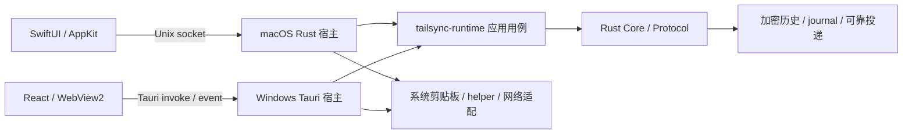
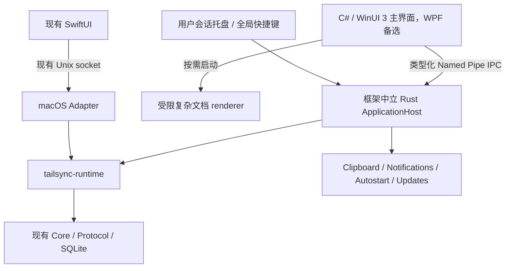

# TailSync 全仓结构、实现与 Windows UI 选型审查

审查日期：2026-10-25（Asia/Shanghai）。基线：`620a963e683eb2bfffff5fb9cc7a00963b1fb6ff` 加当前未提交工作树。开始时有 136 条 Git 状态记录；结论针对工作树，不针对该提交的原始内容。

## 结论

**值得做一次有边界的架构重构，重点是后台宿主与 Windows UI；不建议全项目推倒重写。**

共享 Rust 的协议、加密、配对、数据库、可靠投递、恢复状态机已有相当多正确性投入。`tailsync-runtime` 已提供不依赖 UI 的应用用例，macOS 已有 SwiftUI 原生外壳。这些是迁移的基础，应继续使用。

Windows 的问题不只是 React 组件大小：Tauri 同时承担后台宿主、剪贴板适配、窗口、托盘、快捷键、更新和 IPC。直接把 TSX 改成另一套 UI，仍然绕不开后台与 Tauri 的耦合。适合的改造顺序是：修复确定缺陷、测量资源、验证原生历史窗口、抽离后台宿主，再逐步迁移界面。

用户已明确选择“优先 Windows 原生体验，接受 C# / WinUI / WPF”。据此将推荐调整为 **C# + WinUI 3 + Rust 后台，WPF 作为成熟桌面交互的对照与备选，Slint 降为资源优先的备选**。原生体验优先，低内存仍是验收要求；此处是候选排序，不是未经测量的性能排名。

本次完成全仓结构盘点与关键链路深入审查、实际测试、两个定向探针及官方资料查证。没有 Windows 执行环境，未测得 WebView2 真实进程树内存，没有证明任何替代框架能达到特定 MB 数。代码检查和 host 测试不能替代 Windows 原生运行、双设备与安装升级验收。

## 1. 当前结构与保留价值

统计 `shared/`、`windows/`、`macos/`、`scripts/`、`tools/`、`site/` 中 Rust、Swift、TS/TSX、MJS、Python、C# 文件，共 **702 个、228,429 行**。包含测试和生成代码，排除文档中的源码快照、依赖和构建产物，不能把它当作纯业务代码体积。

| 区域 | 当前职责与评价 | 处理方向 |
|---|---|---|
| `shared/rust-core` | 138 个统计文件、85,800 行；加密、存储、配对、传输、内容解析、恢复、资源预算 | 保留正确性规则；对职责混合模块作内部拆分，不重写协议 |
| `shared/tailsync-runtime` | 25 个文件、13,438 行；历史、预览、归档、契约、后台执行 | 继续作为两端共同应用层；补齐宿主生命周期和事件接口 |
| `tailsync-protocol` / classifier / themes | 协议、纯分类、主题格式分离 | 保留；新 UI 直接消费契约和主题数据 |
| `shared/platform-*.rs` | 16 个 canonical include 源、8,327 行；避免平台复制 | 逐步变成有显式依赖的编译模块，不长期依赖 include 上下文 |
| Windows Rust | Tauri 进程承载后台服务与 UI | 抽出不依赖 Tauri 的用户会话后台宿主 |
| Windows React | 历史/收藏/设置/连接/预览五入口 | 原生迁移的主要替换范围；先做高频历史入口 |
| macOS SwiftUI | 原生菜单栏、窗口、预览、权限 | 保留；AppDelegate 与历史页面继续按状态机职责拆分 |
| macOS Rust | Unix socket API + 后台服务，但仍使用 Tauri 宿主 | 后续共用中立宿主，避免与 Windows UI 重写同时迁移 |
| site、主题包、工具 | 官网独立；主题和 helper 有各自契约 | 官网继续 Web 技术；不要为了客户端原生化重写网站 |
| CI / 发布 | 双平台编译、打包、协议漂移、生成契约、RustSec、回归证据 | 基础较完整；补资源与真实交互门禁，整理当前状态入口 |

当前主链路：



值得明确保留的实现：

- Noise 会话、身份与配对校验，系统密钥保护，以及密钥不可读时不悄悄生成新密钥的策略。
- 文件提交后 ACK、续传 journal、复合内容恢复的副作用日志、来源识别和版本兼容边界。
- `execution.rs` 的阻塞线程调度、读取消与许可预算；不能因换 UI 又在 UI 线程上解密、查询。
- 原始二进制预览响应、文档结构契约、生成解码器、跨平台 fixtures。
- 历史分页、缩略图缓存上限、PDF 按页清理、Markdown 清洗、SVG sandbox。
- 独立功能开关、条件数据库迁移、已有数据库回退和旧版本互操作测试。

## 2. 发现与改进优先级

下表区分“已复现缺陷”“源码确认的边界不足”和“结构改进”。P1 表示应在扩大预览使用或发布前优先处理，不表示已证明远程代码执行。

### F1 · P1 · DOCX 的 HTML 子文档缺少独立隔离

**证据：** `windows/src/preview/renderers/DocxPreview.tsx:29` 将同步得到的文件交给 `docx-preview.renderAsync`，没有关闭 `renderAltChunks`。当前安装的 `docx-preview` 在 `dist/docx-preview.mjs:3585` 把 altChunk 原文放进 `iframe.srcdoc`，默认 `renderAltChunks: true`，没有 sandbox。

本次构造 **2,030 字节**的无害 DOCX，调用实际安装的渲染库，确认产生 `iframe`、`sandbox = null`、srcdoc 保留原始 HTML 与 form。没有运行攻击脚本、网络请求或利用链。Tauri 顶层 CSP 仍然存在，不能由此直接断言 CSP 绕过或 RCE；可以确定的是，该输入没有得到 SVG 路径相同的隔离。

**改进：** 若不需要 altChunk，明确设置 `renderAltChunks: false`；若需要，使用独立受限 renderer、sandbox 和严格内容策略。链接打开、表单、导航与资源读取应有显式策略。添加 DOCX altChunk 回归，而不是仅测试 PDF/SVG。新原生 UI 同样应将复杂文档视为不可信输入。

### F2 · P2 · 一次历史读取失败会被误记为该版本已成功处理（已复现）

**证据：** `windows/src/pages/History.tsx:463` 在 `await loadHistory()` 之前推进 `lastVersion.current`。`loadHistory` 在约 414 行捕获失败、显示提示并正常返回。之后同一 `history_version` 的快照不会再查询。

定向回归：正常载入 → 新历史版本到达 → 注入一次查询失败 → 后台读取恢复 → 连续送入三次相同历史版本的有效快照。查询次数保持 3，没有再次查询，断言 `> 3` 稳定失败。即使已有 507 项前端测试最终全绿，此用例仍为红。

**影响：** 临时数据库/IPC 错误之后列表可能保持旧内容，直到历史版本再次变化、用户改变查询或重开窗口。

**改进：** 区分“观察到的版本”和“成功应用的版本”；让查询返回成功/失败/被替代的明确结果，仅在当前查询成功提交后确认版本。失败采用有界退避，查询变更/窗口关闭时取消。不要在旧请求完成后把新请求的版本回退。

### F3 · P2 · DOCX 缺少解包后资源预算和可终止的渲染生命周期

**证据：** `DocxPreview.tsx:29–63` 一次性将内容复制为 Blob，再调用整个文档渲染；`useBase64URL: true` 为内嵌资源生成 data URL。清理只设置 `active = false` 并清空容器，不能取消库内解包与布局。库的 `renderAsync` 在异步解析/渲染完成后仍直接写容器。Core 的文件预览长度上限不等于 ZIP 解压大小、图片像素数、DOM 节点数上限。

**影响：** 高压缩比文档、大量图片/节点、快速切换或关闭预览仍可能产生明显峰值与废弃计算。父层按条目 key 重建组件已降低跨条目覆盖风险，因此这里不将其报告为已复现的“文档 A 覆盖 B”。尚未进行恶意 ZIP 压力测试。

**改进：** 校验解包总量、条目数、单资源与像素预算；解析采用可终止 worker/独立进程；先生成隔离结果，校验 generation 后安装到当前视图。超预算要可解释地降级。关闭窗口必须终止任务或明确等待并持有预算，不能只忽略返回值。

### F4 · P2 · 缩略图仍需要全图处理，且最后缩放发生在异步执行线程

**证据：** `windows/src-tauri/src/commands/preview.rs:13–29` 取得完整 PackedImage 后直接运行 `thumbnail_rgba`。`api.rs:444` 起的 box averaging 遍历输入像素；`history_display.rs:147` 的路径为分析/完整像素保留预算，再返回完整数据。已经释放原始数据再编码，是正确优化，但不消除全图解码和像素遍历成本。

现有 TS 缓存有 4 MiB 上限、64 项排队上限和串行请求，不能描述为无限缩略图泄漏；缓存随窗口销毁而消失，重开/跨窗口仍会重复请求。后端 key/spec 中的 48 与 Windows 实际 160px 生成策略也需要统一语义，避免新 UI 再复制一套尺寸规则。

**改进：** 共享 `ThumbnailService` 返回最终缩略图；缩放也在有界 blocking worker 完成。以内容身份、归档修订、规格、DPI 为键，设置后台缓存的字节和数量上限；迁移/删除清理。优先小尺寸解码，无法小尺寸解码时保留完整预算。若持久化缩略图，应保持与历史相同的隐私要求。

### F5 · P2 · 后台已经分层，但尚不能直接脱离 Tauri

**证据：** `windows/src-tauri/src/lib.rs:29` 的任务类型、AppState 和启动/退出编排依赖 Tauri；`sync_adapter.rs:3、52、252` 使用 AppHandle、Tauri clipboard plugin 与 Tauri Image；`clipboard.rs:25、129` 将剪贴板读取和服务启动绑定到宿主。macOS daemon 也还由 Tauri Builder 启动。

**影响：** 更换 UI 的成本高于“替换 React 页面”；后台异常和 UI 生命周期仍处于同一宿主。只剥掉 WebView 页面仍可能保留大量 Tauri 依赖与适配逻辑。

**改进：** 将服务组装与资源所有权放入框架中立的 `ApplicationHost`；定义 Clipboard、Notifications、WindowActions、Autostart、Updater、RuntimeEvents 等必要接口。已有 ClipboardPort/应用用例应扩展和复用，不另造一套同步规则。

### F6 · P2 · canonical include 防漂移有效，但依赖边界隐式

**证据：** `shared/platform-network-server.rs:1` 使用 `super::*`，同文件又使用 `crate::api` 等宿主状态；多个平台模块以路径 `include!` 编入。API 层仍保存 revision、notifications、文件进度和取消集合等进程全局状态。

**影响：** 两个宿主上下文必须匹配；Rust crate 边界不能独立验证依赖；测试经常需要串行锁和全局环境。迁移宿主时容易同时牵动网络、状态和 UI。

**改进：** 按用例分批迁入可独立编译的模块，显式传入 `RuntimeEvents`、Storage、ClipboardPort 和 Cancellation。先迁进度/通知/生命周期，再迁传输编排。不要为“目录对称”把每个小文件都变成 crate，也不要简单把 include 改成另一个 include。

### F7 · P2 · 大模块仍集中多种变化原因

**证据与边界：** `db/composite.rs` 共 5,617 行，但主测试模块从 2,931 行开始，不能把所有行当生产代码；`runtime/history.rs` 共 2,408 行，主测试从 1,483 行开始。与此同时 Windows History 1,195 行、Swift HistoryView 1,420 行、TailSyncApp 1,282 行仍包含较多业务状态/生命周期编排。

**改进：** 数据库复合模块按 manifest 编解码、提交事务、归档更新、查询准备/分析拆分；保持事务边界。历史界面按查询会话、选择/键盘、恢复、预览关联拆成明确状态机。Swift AppDelegate 按 daemon、通知、窗口路由、启动引导分离。成功标准是降低一次修改涉及的职责，不是仅将长文件移动到子文件。

### F8 · P2 · 资源目标尚未成为可重复的产品门禁

已存在 256 MiB 的复合 pipeline **记账预算**（`composite/budgets.rs:49`）、并发限额和预览内存 lease；这不是进程 RSS/Private Bytes 上限，也不覆盖 JS、WebView2 GPU、SQLite、分配器保留等全部资源。

历史验收文档曾明确 WebView2 长时内存项目缺证据。本次也没有取得当前工作树的 Windows 原生曲线。不能据此认定当前一定泄漏，也不能把历史本地 PASS 当本次内存验证。

**改进：** 增加固定数据集、场景、进程归属、冷/热启动、长期斜率与 UI 时延的基准；UI 迁移按同一基线比较。见第 5 节。

### F9 · P2 · 前端全量测试存在时序不稳定

首轮 505/507 通过；失败涉及折叠批次预览、Escape 后晚到预览。单文件 69/69 通过，再次全量 507/507 通过。不能只保留最后一次绿，也不能把首轮两个失败直接定性为稳定产品 bug。

**改进：** 测试等待“查询可操作/焦点稳定/命令已进入队列”等真实状态，避免仅因文字已渲染就连续发送键盘事件。回归应覆盖并发查询、窗口关闭、跨窗口恢复与异步完成，不以延长 sleep 或重复重跑代替修复。

### F10 · P3 · 工程与文档的维护成本可继续降低

- 当前根 workspace、两个独立平台 manifest/lockfile 有意隔离发行。已有 resolution/drift gate，不建议为了整齐立即合并；抽出新宿主后重新评估。
- 旧架构报告仍记录 Windows all-targets fixture 阻断，本次已通过；需在“当前状态”入口集中列出哪些已解决、哪些仍待原生验收，历史报告继续保留。
- 本次 Windows lint 有 23 条 warning，主要是 effect/state 与依赖。逐条判断语义，不能机械删依赖或静默禁规则。
- 新手引导已共享 JSON，但主 UI 文案仍分散在 Swift 与 Windows JSON。可统一 key/消息参数契约，不必强迫两端使用同一种 UI 国际化实现。
- Windows 默认 capability 将托盘和一批窗口操作同时给予预览窗口。新设计应拆分权限，特别是可显示不可信文档的 renderer；应用自定义命令还需单独评估，不能认为拆 capability 就自动覆盖全部命令。

## 3. WebView2：当前已经做了什么，还有什么问题

源码确认的现有优化：

1. Tauri 配置 `windows: []`，窗口按需创建，不能说五个页面一直常驻。
2. history/favorites/settings/connections 隐藏后 **5 秒**销毁，generation ticket 防止旧关闭任务销毁重开窗口：`window_lifecycle.rs:10、354`。
3. preview 有关闭并销毁的单独生命周期：`window_lifecycle.rs:317`。
4. PDF、DOCX、Markdown、代码预览使用动态导入：`PreviewContent.tsx:9`。
5. 大预览已经使用原始二进制响应，不能再笼统建议“把所有 base64 改成二进制”。主要剩余 base64 路径包括缩略图和 DOCX 内嵌资源。
6. `useVisiblePolling` 在隐藏时停止；runtime snapshot 长轮询则没有同样的可见性门控，在窗口最小化而不销毁时仍可继续工作。

WebView2 的 browser/renderer/GPU 等进程有固定成本；环境和 user-data-folder 可影响进程共享，**窗口数不等于完整进程组数**。销毁一个控件也不能由源码推断所有相关进程立即归零。微软官方文档建议环境共享、隐藏后的暂停和 memory target 等手段，但需核实 Tauri/Wry 暴露接口、版本与恢复行为。

如果要维持现有架构，可继续测：长轮询可见性门控、实际环境共享、隐藏期的低内存目标/暂停、缩略图服务、DOCX 边界。没有证据支持关闭 GPU 或每次强制 trim working set；这可能只把代价转移到 CPU、缺页与重开卡顿。

**换 Vue/Svelte、改 CSS、减少 JS bundle 可以改善一部分开销，但不会消除 WebView2 的浏览器运行时成本。** Electron 不符合本次资源目标；Wails 或其他仍以 WebView2 呈现 Windows 主界面的方案也不能根本改变这一点。

## 4. Windows 新 UI 技术比较

下表中的资源判断是架构潜力，尚未测量 TailSync 等价场景。下载体积、窗口数、进程数均不能直接替代内存指标。

| 方案 | 对本项目的价值 | 主要代价/待验证点 | 建议 |
|---|---|---|---|
| **C# + WinUI 3 + Rust 后台** | Fluent、现代 Windows 控件与系统视觉更自然；主界面可完全不用 WebView2 | Windows App SDK 运行时/部署成本；托盘、全局快捷键、焦点返回仍需 Win32 互操作；不能承诺内存低于 WPF/Slint | **按用户偏好首选 PoC** |
| **C# + WPF + Rust 后台** | Windows 桌面能力成熟；文字、输入法、UI Automation、列表虚拟化与窗口互操作有成熟基础；不依赖 WebView2 | 引入 .NET/C# 与 IPC；主题需要重做；Fluent 风格需设计；现代外观并非默认获得 | **桌面交互对照与备选** |
| **Rust + Slint** | 不需要浏览器；与 Rust 用例直接集成；声明式 UI；可对比 software/GPU renderer | winit 路径主要是自绘控件，不等于 WinUI 系统控件；输入法、无障碍、焦点返回、多窗口、阴影/透明需实测；复杂文档非现成浏览器能力；许可证需按选定版本确认 | 资源优先备选，当前不作为主路线 |
| Rust + Iced | Rust 一体化，消息/状态更新方式清晰，wgpu 与软件 renderer | 官方 README 仍标 experimental；需要检查当前发布版能力、API 稳定性与目标交互；复杂文档生态成本 | 第二轮候选 |
| Rust + egui | 原型和诊断工具开发快，无浏览器 | 文本编辑、无障碍、桌面细节、复杂文档适配需要验证；不能把“即时模式”直接等同于必然高 CPU | 诊断工具合适，主客户端不首选 |
| C# + Avalonia | 自绘跨平台 UI、XAML 生态、无需 WebView2 | 项目已经有成熟 SwiftUI；再引入跨平台 UI 的收益有限；.NET 与绘制资源仍需测 | 计划未来统一多个桌面端时重评 |
| Flutter Windows | UI 一致性与动画能力强，无浏览器要求 | Dart、Flutter engine、Rust bridge 和桌面插件增加维护面；不自动等于低内存 | 当前目标下不优先 |
| C++ + Qt / 原生 Win32 | Qt 桌面生态完整；Win32 自绘有较低资源上限的潜力 | C++/FFI、部署/许可或大量控件实现工作；维护代价相对收益偏高 | 除非有相关团队经验，不首选 |

Slint 不应被误写成“MIT 库”：其官方仓库当前列 GPLv3、Royalty-free、Commercial 多种许可路径；Royalty-free 有使用披露等条件。TailSync 自有源码为 MIT，不代表链接产物自动只受 MIT 约束。PoC 应固定 release/tag 与 renderer features，再检查对应许可和 Rust 最低版本；本报告引用的 master 信息不是发布版承诺。

Slint 已有 accessibility feature，不能简单说它“不支持无障碍”；同样，存在该 feature 也不等于本项目的 Narrator、焦点和中文输入已验收。

### 用户偏好确定后的具体选择

优先使用 **C# / XAML / WinUI 3** 实现历史、收藏、设置、连接与引导。保留 Rust 的加密、数据库、配对、传输和剪贴板规则，通过本地 Named Pipe 调用类型化用例。不要在 C# 中再实现一套业务规则，也不要用 WebView2 包装现有 React 页面来代替原生迁移。

第一轮原型必须包括快捷键唤起、中文输入法组合态、方向键/空格/Enter/Escape、多屏 DPI、Narrator、复制后返回原目标窗口，以及托盘和单实例行为。WinUI 3 的现代外观不自动解决这些交互；若在关键路径出现难以控制的兼容性或启动代价，用相同用例比较 WPF，而不是仅凭截图决定。

托盘、全局快捷键与剪贴板监听由 Rust 用户会话宿主持有；C# UI 可按需启动和退出。UI 完全退出能释放其 .NET/Windows App SDK 进程资源，但会增加下次唤起成本。是否短时保留 UI 进程，由热开延迟与空闲资源实测决定，不预设“每次关窗立即杀进程”。

### 富文档预览是迁移成本的主要变量

历史列表、连接和设置适合原生化；预览需要分开设计：

- 文本/代码：有长度上限的原生文本视图；高亮异步计算。
- 图片：WIC 或有像素预算的解码器，避免每层重复持有完整 RGBA。
- PDF：可评估 Windows PDF API 或 PDFium。前者按页输出图像等能力不等于现有 PDF.js 的文本选择、搜索和全部交互；后者带来分发、更新和许可工作。
- 结构化复合内容：复用已有 `DisplayDocument`，实现段落/表格/图片子集，保留“不完整”的真实状态，不重写内容判定规则。
- DOCX：优先安全的受限文档模型；完整 Office 排版兼容不应成为第一个原生窗口的前置要求。
- HTML/SVG：如保留浏览器能力，放到按需启动、关闭即结束的独立 renderer 进程，限制命令与资源访问。这样常用窗口无需浏览器，但打开该预览时仍会付出 WebView2 成本。

若要求“任何时候都不能出现 WebView2”，必须接受受限原生渲染或投入更多富文档兼容工作。不要把当前能预览的格式静默删除后宣布迁移完成。

## 5. 必须先建立的 Windows 资源对照

固定 release 构建、同一机器/屏幕 DPI、同一输入集、相同网络/配对状态。记录系统版本、WebView2/.NET/SDK/Slint 版本、CPU/GPU、数据量。用合成内容，避免采集用户剪贴板正文。

| 场景 | 观察内容 |
|---|---|
| 冷启动，仅托盘；空闲 10 分钟 | 后台基线、UI/浏览器进程是否存在、CPU 与唤醒 |
| 首次/热打开历史；分别 1k/10k 条历史 | 快捷键到首帧/可操作的 p50/p95、搜索延迟、内存增量 |
| 历史 + 收藏 + 设置 + 连接 | 多窗口边际成本、共享进程、重复订阅/缓存 |
| 混合大图、100/500 页 PDF、受限 DOCX | 峰值、解码复制、翻页/缩放、快速切换、取消 |
| 开关历史/预览 100 次，关闭 5 秒/30 秒/5 分钟 | 回落基线、句柄/任务数量、重开时延、增长趋势 |
| 连续同步并搜索/预览，休眠恢复 | UI 是否拖慢传输、退避行为、状态恢复 |

同时采样本产品整个进程树的 **Private Bytes（提交）** 与 **Private Working Set（驻留）**，另列总 working set、GPU 内存、句柄/线程、CPU、延迟。共享 working set 直接求和可能重复计算；GPU 共享资源也不能随意归属。可用 Process Explorer/Performance Monitor 做快速检查，WPR/WPA 做分配和线程归因。

建议的 PoC 决策标准（提案，不是已实现数字）：

- 仅托盘时不需要 UI/浏览器进程；如果设计保留原生 UI 同进程，必须证明它的空闲增量值得保留。
- 历史窗口等价功能的进程树 private commit，目标比现有方案降低至少 40%；若达不到，重新评估迁移收益。
- 快捷键热开 p95 不劣于基线，中文输入、键盘选择、Escape、原目标窗口恢复全部通过。
- 100 次开关后资源趋于稳定，不能通过强制 working-set trim 掩盖分配增长。
- 同步吞吐、重复发送控制、数据恢复与 UI 崩溃隔离不退化。

主对照采用 WinUI 3 与 WPF 的等价历史窗口，分别测 UI 进程保留与退出后的资源和唤起延迟。若后续回到 Slint 备选，再比较软件与 GPU renderer；不能只测空白窗口选赢家。

## 6. 重构目标与可回退迁移顺序



**后台必须留在登录用户的交互会话中。** 不要为进程隔离直接做 Windows Session 0 系统服务，否则托盘、剪贴板和焦点行为会出现新的问题。

建议演进目录，具体名称可在实施时调整：

```text
shared/
  rust-core/                 保留现有核心，不为 UI 迁移改协议
  tailsync-runtime/          用例、类型化事件、取消、资源预算
  tailsync-host/             新：后台生命周期与依赖装配
platform/
  windows/                   Win32 clipboard、tray、hotkey、notify 等适配
windows/
  native-ui/                 PoC 成功后逐步成为主 UI
  src-tauri/                 迁移期现有入口，保持可回退
  src/                      迁移期 Web UI / 可选 preview renderer
macos/
  swift-ui/                  继续保留
```

| 阶段 | 交付内容 | 完成条件 |
|---|---|---|
| 0：稳定基线 | 修复 F1/F2，补 DOCX 限额方案，修复不稳定测试；保存资源基线 | 确定缺陷有回归，版本与测试包来源明确 |
| 1：验证选型 | C# + WinUI 3 历史窗口，使用真实历史用例但独立测试数据；以 WPF 验证关键桌面交互的取舍 | 列表、中文搜索、键盘、预览、DPI、焦点、读屏及内存测量满足标准 |
| 2：抽离宿主 | 明确 State/任务/预算所有权；进度通知与 ClipboardPort 不依赖 Tauri | 后台无 WebView 启动和停止；现有 UI 仍可用；同一用例测试通过 |
| 3：迁移主入口 | 历史/收藏，再连接/设置/引导；迁托盘/快捷键/通知/启动项 | 业务仍经同一 Core；无双数据库拥有者、双剪贴板监听者 |
| 4：预览与卸载旧栈 | 按格式迁移；决定是否保留受限浏览器预览进程 | 格式能力表、权限、取消、内存与降级体验完整 |
| 5：发行验收 | 单实例、deep-link、更新签名、安装身份、旧数据、卸载、N-1 | Windows 真机、干净安装和双设备通过，才替换默认发行包 |

当前 C# 路线优先同用户 Named Pipe；只允许本机、设置 SID/DACL、验证会话/对端、限定帧长与并发、版本协商、请求 ID/取消与有界事件流。这样 UI 可以退出或重启而不停止同步。若选择同进程 Rust DLL + P/Invoke，则需另外解决 ABI、内存所有权、回调线程和 panic 边界，且 UI 与后台生命周期绑定，因此不作为此次首选。不要为 UI 重新开放 localhost HTTP/TCP，也不要让 UI 直接读取 SQLite 或密钥。

Named Pipe 的进程隔离会增加协议和拷贝成本，不是免费优化；在需要 UI 独立生命周期时才采用。原始预览采用已有二进制帧语义，避免大对象 JSON/base64。升级需协调 UI/host 版本并保证后台仅单实例。

主题保留现有主题包 schema、颜色和资产，新增原生 renderer 映射；CSS 选择器和布局不能直接复用。系统通知、自动启动、更新验证、引导安装标记也都属于迁移清单，不能只搬可见页面。

## 7. 本次验证结果

测试使用仓库隔离器运行，未启动日常 TailSync 生产实例、未做真实配对或发布。未修改产品实现；为复现 F2 临时生成测试文件，执行后移除，探针源码与日志保存在审查证据目录。

| 检查 | 结果 |
|---|---|
| Windows 前端全量 | 首轮 505/507，2 失败；相关文件复测 69/69；第二轮全量 507/507 |
| F2 新定向回归 | **失败，确认缺陷**；不是现有套件中的两个时序失败 |
| Windows 前端 build | 通过；PDF/DOCX 仍为独立 chunk |
| Windows lint | 退出 0，23 warning |
| Core + runtime 默认测试命令 | 退出 0；Core 单元 988 passed / 3 ignored；runtime 单元 87 passed；其余集成测试见日志，部分 feature-gated suite 执行 0 项 |
| Core 开启复合/修复/协议 feature 的单元测试 | 1001 passed / 3 ignored，串行执行 |
| Windows Rust `check --all-targets` | macOS host 上通过；旧报告中的 fixture 编译阻断本次未出现 |
| Windows Rust `test --lib` | macOS host 上 186 passed / 2 ignored，**不代表 Windows cfg 分支验证** |
| macOS Rust `test --lib` | 174 passed / 5 ignored |
| Swift 测试 | 417 executed，5 skipped，0 failures；未开启真实 WKWebView opt-in 路径 |
| Node 工程脚本测试 | 173 passed |
| 根 workspace fmt | 通过 |
| 跨平台契约 | 通过 |
| canonical include 检查 | 16 个源，两端接线通过 |
| 本地生成契约/解码器检查 | 通过；137 文档 corpus、19 frame corpus；85 Windows / 49 macOS 命令分类 |
| DOCX altChunk 无害探针 | 复现未 sandbox 的 srcdoc iframe；未测试 CSP 利用或实际 WebView2 行为 |
| Windows 进程树内存、原生交互、完整安装升级、双设备 | **本次未执行** |

证据：`artifacts/project-review/2026-10-25/`。源码清单/哈希仅用于绑定本次工作树，不把历史报告或本次测试提升为生产环境验收。没有为审查修改产品版本、协议或数据库。

## 8. 官方资料与选型依据

以下资料于 2026-10-25 查阅。链接可能随版本更新；实际 PoC 应固定发布版。

1. [Microsoft：WebView2 process model](https://learn.microsoft.com/en-us/microsoft-edge/webview2/concepts/process-model) — 多进程与环境/进程共享。
2. [Microsoft：WebView2 performance](https://learn.microsoft.com/en-us/microsoft-edge/webview2/concepts/performance) — 冷启动、环境共享、暂停、低内存目标、GPU 成本。
3. [Microsoft：WinUI 3](https://learn.microsoft.com/en-us/windows/apps/winui/winui3/) — Windows App SDK 原生 UI。
4. [Microsoft：WPF overview](https://learn.microsoft.com/en-us/dotnet/desktop/wpf/overview/) — Windows/.NET 桌面框架与控件能力。
5. [Slint：Backends & Renderers](https://docs.slint.dev/latest/docs/slint/guide/backends-and-renderers/backends_and_renderers/) — winit、软件、FemtoVG、Skia 等路线。
6. [Slint：LICENSE.md](https://github.com/slint-ui/slint/blob/master/LICENSE.md) 与 [Rust feature 定义](https://github.com/slint-ui/slint/blob/master/api/rs/slint/Cargo.toml) — 许可选择、accessibility、renderer 等，master 不等于固定 release。
7. [Iced 官方仓库](https://github.com/iced-rs/iced) — 架构、renderer 与 experimental 声明。
8. [Avalonia 官方文档](https://docs.avaloniaui.net/docs/welcome) — 跨平台原生应用路线。
9. [Flutter：Windows building](https://docs.flutter.dev/platform-integration/windows/building) — Windows 工具链与部署。

**最终建议：按用户确认的 Windows 原生体验优先级，先修已复现问题并建立内存基线，以 C# + WinUI 3 历史窗口验证交互与资源表现，WPF 作对照，再进行后台宿主和 Windows UI 的分阶段重构。保留共享 Rust 核心与现有 macOS 原生 UI。**
