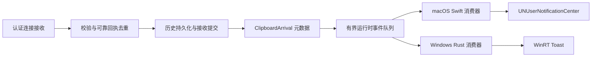

# 通知投递修复与现有全部路径（2026-10-23）

本轮修复位于工作区，尚未打包替换 `/Applications/TailSync.app`。此前安装的 RTF 修复包保持运行。下文描述本轮源码的最终行为，不能当作 Windows 原生界面或实际系统通知已经验收的证据。

## 本轮修复

1. 两端删除“取最新一条历史 + 推进历史 ID”的到达检测。接收事务完成后产生 `ClipboardArrival`，按认证设备指纹及消息/批次 ID 去重，历史排序、本机复制和复用旧历史行都不会覆盖到达事件。
2. 同一设备的普通到达使用同一替换键。读取一个事件快照时，每个设备只提交最新摘要，正文带累计项数；文件批次提交完成后只产生一次事件，数量为整个批次的文件数。
3. macOS 的无界面 Rust 后台也会把文件到达交给 Swift；此前成功路径只有日志。文件/剪贴板错误和存储状态使用固定消息代码进入同一 Swift 消费路径。
4. Windows Cargo metadata 与 Tauri identifier 均为 `com.tailsync.desktop`，漂移检查阻止再次分叉。
5. Windows 系统通知全部改走自身的 WinRT 发射点，替换原来的直接 Toast 及插件调用。同步提交错误和异步 `Failed` 回调均记 warn；注册失败不发送通知，不重试业务。保留每个替换键最新的 Toast 对象，保证进程存活期间激活/失败回调的对象生命周期。
6. Windows 为当前用户注册自身 AUMID 的显示名和图标，安装版、开发构建及便携启动使用同一身份来源。普通卸载清除该注册，升级不清除。此处实现了注册路径，三种构建是否实际显示仍需 Windows 验收。
7. 普通到达 macOS 使用 `.passive`，Windows 使用 `SuppressPopup(true)`；错误独立成卡，不被到达替换。macOS 前台 delegate 只返回 `.list`。两端添加运行中点击回调，打开历史窗口；精确跳条目与 Windows 退出后的冷启动未实现。
8. macOS 首次启动消费器时，只清理旧版 `tailsync-<数字历史ID>` 到达卡片，保留旧的问题通知。设置页的存储迁移完成提醒也遵守通知总开关，并使用固定 identifier。

没有修改 `PlatformResultFuture = Result<(), String>`、文件提交/ACK 的返回契约、原生剪贴板写入重试规则或数据库 schema。新增的 `SyncPlatform.received_content` 是提交后的元数据 hook，平台只入内存事件队列，不在引擎锁下执行系统通知 I/O。local contract 的 `arrival`/`code` 是可选增量字段，Swift/TypeScript/schema/fixture 按 Rust DTO 重新生成。

## 共享的到达事件如何产生

`ClipboardArrival` 只含认证来源 ID、设备显示名、消息/批次 ID、内容类别、数量，以及可选历史条目 ID。它不含文本、文件名、路径或原始错误。来源指纹来自已认证连接，不能通过同名设备合并，也不从显示名反查设备身份。

| 接收类型 | 生产位置与时机 | 重复与特殊结果 |
|---|---|---|
| 可靠文本/图片 | Core `peer/event_receiver.rs`：处理完成、接收回执和历史确定后，ACK 写出前调用 hook | 重发直接读回执，不再产生事件；删除墓碑或没有可用历史引用不产生到达；本机历史写入没有这个 hook |
| 复合内容 | Core `peer/composite_receiver.rs`：持久化终态完成后产生事件 | 重发命中已完成回执直接返回；`StoredIncomplete`、`Superseded` 等仍表示内容已保存，允许通知“到达”，不宣称已成功写入系统剪贴板；原生应用问题另有 sync warning |
| 文件批次 | 两端 `sync_adapter.rs::files_received`：历史批次事务成功且 `batch_complete` 后 | 半批不通知；`source_id + files:<batch_id>` 在留存窗口内去重；`count=batch_total`。后续文件剪贴板写入失败，不撤销“文件已保存”的事实，另发剪贴板错误 |

队列最多保留 **256 个事件**，有独立递增事件 ID。对同一来源，后续事件带上该来源最近留存摘要的累计数；新消息即便引用同一历史行也会计数。一个文件批次中的每个文件计一项，文本/图片/复合剪贴板一次接收计一项。混合类型摘要使用“内容”。计数在进程重启，或该来源完全离开留存窗口后重新开始，不是永久未读数。

本机复制、删除、收藏、搜索、预览和历史回溯只更新历史/剪贴板状态，不会伪造远端到达事件。事件队列是内存提示机制；进程崩溃不提供持久 exactly-once 通知承诺，历史和接收回执仍由原有持久规则保障。

## macOS 的系统通知路径

Rust 后台没有窗口。到达与问题事件通过本地 Unix socket 的 `wait_runtime_snapshot` 返回，Swift 用独立 `notificationEventId` 增量消费。请求最多等待约 2.5 秒，状态改变会提前唤醒；失败后的 750 ms 才是重连等待，不是正常固定轮询周期。

| 事件 | Swift 正文来源 | 通知键与级别 |
|---|---|---|
| 文本、图片、复合内容、文件到达 | `arrival.kind/source_name/count` 选择本地化模板 | `tailsync-arrival-<认证来源ID>`，`.passive`，无声；同一来源只有一张新格式到达卡 |
| 文件已保存但未能更新剪贴板 | `clipboardUpdateFailed` 固定模板 | 独立 clipboard 问题键，`.active`，无声 |
| 文件准备、发送、接收批次失败 | `fileTransferFailed` 固定模板 | 独立 transfer 问题键，`.active`，无声 |
| 存储不可用/恢复 | `storageUnavailable/storageRecovered` 固定模板 | 二者使用同一个 storage 问题键；失败 active，恢复 passive，不覆盖其他问题或到达 |
| 开始迁移存储 | 后台的 `storageMoving` 固定模板 | 独立迁移键，passive |
| 存储迁移完成 | Settings 页 API 成功后发 `settings.storageChanged` | `tailsync-storage-changed`，passive，总开关关闭时不提交 |
| 消费缺口 | `notificationEarliestAvailableId` 与当前 cursor 比较，生成缺口模板 | 单独 gap 键，passive；同时打印遗漏数量，不把缺口当成完整读取 |
| 未知问题代码 | 按 error/warning 或其他级别选择固定通用模板 | 不把 daemon 的任意 `message` 字段发布到 OS |

所有 Swift 后台投递均经过 `submitNotification`，捕获原生 `add` 的错误并报告；存储完成投递有独立的 do/catch，失败不会把已完成迁移改报为失败。通知开关、真实 `.app` 包和后台生命周期是提交门禁。系统通知授权、Focus 和系统通知设置继续由 macOS 决定。

服务实例变化时重置事件 cursor，避免把旧进程的 ID 套到新进程；窗口内出现缺口时记录并继续消费保留事件。运行中点击通知打开历史窗口。前台 delegate 只保留通知中心展示，不显示横幅；这不是完整的“系统提示转 inline 并确认交接”的实现。

Apple 对同 identifier 的已送达通知执行替换时会再次提醒。因此本轮按快照合并后提交，普通到达依靠 passive 降低打断；**没有把同 ID 反复 add 宣称为静默更新，也没有实现冷却期内刷新或完整预算状态机**。

## Windows 的系统通知路径

到达消费器等待 runtime revision（最多等待 15 秒，变化会立即唤醒），从同一事件队列一次取出 `cursor` 之后的全部事件。它不查询最新历史，不受当前 React 窗口是否打开影响；同一快照按认证来源合并后提交。读取缺口会产生 warn 及内容无关的缺口卡片。

其他生产者仍各自判断业务条件，但最终全部调用 `notifications::show`：

| 事件/生产者 | 替换键 | 展示方式 |
|---|---|---|
| 到达消费器 | `arrival:<认证来源ID>` | 本地化来源/类型/数量；`SuppressPopup(true)`，无声，进入通知中心 |
| 接收文件后，材料化或文件剪贴板写入失败 | `issue:clipboard` | 固定“内容已保存，但未能更新剪贴板”，允许系统横幅，无声 |
| `SyncPlatform.file_batch_failed` | `issue:transfer` | 系统固定传输失败文案；另把错误放入页面 runtime feed |
| 发送侧 `ClipboardRuntime.notify_file_batch_error` | `issue:transfer` | 系统固定传输失败文案；页面 runtime feed 保持原有详细诊断 |
| 存储不可用/恢复监视器 | `issue:storage` | 不可用允许横幅，恢复只进中心；同键更新状态 |
| 存储迁移 hook | `storage:moving` | 迁移前的固定提示，只进中心 |
| 事件队列缺口 | `notification-gap` | 固定遗漏数量提示，只进中心 |

所有键经 BLAKE3 截成 16 个十六进制字符用作 Windows Tag，Group 固定为 `TailSync`。同 Group+Tag 替换；到达、存储、剪贴板和传输错误不会互相覆盖。Toast XML 使用 DOM 文本节点，设备名不能注入 XML；正文只来自共享本地化枚举。

原生发射点使用 Tauri config identifier 创建 ToastNotifier。首次初始化为当前用户注册 `HKCU\Software\Classes\AppUserModelId\com.tailsync.desktop` 的显示名及图标，结果每进程只计算一次；失败明确记日志且停止原生投递，不冒用 PowerShell 身份、不重试传输。安装器的快捷方式也使用同一 identifier；便携/开发启动注册路径不依赖开始菜单快捷方式。

`Show` 的同步错误会记 warn；Toast `Failed` 回调记录异步 HRESULT，当前 Toast 对象按替换键保留以支持回调。这解决了插件在后台 `let _ = notification.show()` 吞错误的问题。系统禁用通知、Focus 或其他系统策略仍可能令 API 成功但无可见横幅；不能用 API 成功充当展示验收。

运行中激活回调打开历史窗口，不改写用户剪贴板。没有 COM 冷启动激活注册，也没有精准定位某条历史的完成协议。

## 窗口内提示与系统通知的关系

Windows `wait_runtime_snapshot` 另向 React 窗口返回 runtime errors、文件进度和 `sync_warning`；`History.tsx` 把 error 交给 `useHistoryNotice`。相同 key 只增次数，不续 TTL；成功/警告/错误 TTL 分别为 1.5/4.5/6 秒，连续可见预算为 8 秒，之后冷却 1.5 秒。这条页面路径不受系统通知总开关约束，关闭 OS 通知不会把页面故障反馈一起关闭。

macOS 历史页从 runtime/storage 快照和 `get_sync_warning` 显示同步及存储提示；存储不可用有持续可见的页内警告。两端 Core 的 `sync_warning` 另涵盖未能保存、部分恢复、内容未共享、投递停滞/过期、文件选择不支持等情况。这些不都转换成系统通知。

因此本轮实现的是“系统发射口收敛、到达事件与历史分离”。Windows 的原生错误通知与页面 notice 可能同时出现；Windows 问题横幅也没有按历史窗口焦点抑制。它不是完整的跨平台单消费器、前台 inline 交接或问题中心。

## 节流、隐私与失败语义

- 存储监视器每 5 秒检查，`warned` 抑制同一持续故障反复通知；恢复后重置，下次故障可再提示。
- 发送重试沿用 Core `outgoing::retry_state` 的退避和通知时机，准备文件等一次性失败按其生产边界报告；本轮没有新增传输重试。
- 普通到达不会替换问题卡；问题类别相同会替换该类别的旧卡。系统自身配额/清理、用户删除和进程重启后的内存队列丢失，不属于应用可承诺永久保留的范围。
- 系统正文禁止剪贴板内容、文件名、路径及原始异常；本地页面和日志维持各自的诊断用途。系统投递失败不撤销成功的历史、文件提交或迁移，也不制造业务重试。
- 新增防御只位于认证接收后的元数据边界、IPC 解码、OS/XML/注册表副作用和原生对象生命周期。内部不重复检查已有类型或格式。

## 验证与边界

最终结果见 `artifacts/notification-delivery-fix/2026-10-23/results.json`，原始日志保留。

- Core peer 回归、接收定向回归与 sync/file 回归验证认证来源、重复投递、提交后通知、三次远端接收穿插本机复制、部分接收和原有 ACK/写入约束。
- Runtime 全量测试验证内容无关文案、批次去重/计数、同名不同来源隔离、相同历史 ID 的不同消息、队列上限和显式缺口。
- 两端 API 测试及 composite-enabled 所有目标检查；Windows 为 macOS host 构建，不能替代 Windows 应用构建。
- Swift AppBehaviorTests 和 LocalContractTests 实际由 Xcode `xctest` 执行，验证文案、passive/active、未知代码安全降级及生成契约。
- Windows `notifications/native.rs` 直接以 `x86_64-pc-windows-gnu` 类型检查，验证真实 WinRT/注册表签名；没有替换该源码或用 Windows cfg 的 host 构建冒充原生检查。检查工程位于证据目录，仅导入生产模块，未运行注册表或通知 API。
- Core/Runtime clippy、格式、local-contract/canonical-include/跨平台检查通过。

最终计数：Core peer 202 项通过（1 项既有 ignored）、接收定向 15 项、sync/file 115 项、Runtime 87 项；macOS API 26 项、Windows host API 15 项（各 1 项既有 ignored）；Swift 行为及本地契约 32 项。各组有覆盖重叠，不能相加成不重复的总用例数。

首轮发现两项修复过程问题：Windows 0.62 的事件回调参数使用 `Ref` 而非旧版 `&Option`，已按依赖签名修正；队列上限从 32 改为 256 后，一个旧测试的固定 `failure 33` 期望过时，已改为按上限计算，保留其完整的增量/溢出断言。首次 SwiftPM 的“无匹配用例”输出只计构建，不计测试，实际执行日志另存。

尚未完成：本轮源码打包/替换、macOS 实际通知中心/横幅/点击验收、Windows 安装/开发/便携运行、Windows 完整原生应用构建及 NSIS 卸载验收、双设备实测。Windows 冷启动激活、精确跳条目、持久问题中心、完整聚合冷却预算和前台 inline 交接仍为独立后续设计。
